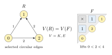

# Circular component expansions

We now extend the ordinary component theorem to a circular diagram. We
replace a circular selected state by a finite signed sum of balanced
selected states, and represent each balanced component by a union of
ordinary components. The coefficients are constant on flip components,
so we may group the terms and apply the ordinary theorem.

Let \(D\) be a circular diagram on the residue set \(V\), and let \(S\) be its
set of strict natural edges. Throughout this section states are admissible:
the selected graph on residues is acyclic. The cover tests for a circular
flip use the integer lift. A selected state \(A\) contains every edge of \(S\)
and any set of normal edges.

We first forget the strict markings, keeping the natural diagram and
selected sets. A strict edge is a maximal natural edge, so it cannot be
exchanged as a short edge under a retained natural long edge. Its selected
status is therefore constant on every component of the undecorated
diagram. The original component remains an entire component there, with
both values unchanged. We may consequently prove the unweighted identity
with all selected edges normal, and restore the original weight at the end.
In the finite expansion below we work in this undecorated diagram.

We write \(\mathsf{K}(A)\) for its strict-coloring value.  We write \(H_A\) for its
entire lifted highest-reachable map, rather than immediately taking its
circular HRV fibre sizes.  Thus \([H_A]\) denotes a basis element of the free
abelian group on such maps.  The linear map

\[
                         [H]\longmapsto \mathsf{E}(H)
\]

sends the second notation to the elementary value of the state.  It will be
useful that the construction below first proves an identity for the entire
map \(H_A\).

Every natural edge has a positive integer length.

::: {.definition #def:balancedSelectedSet title="Balanced selected set"}
A selected set \(F\) is \defin{balanced} if, on every weak component of \(F\),
there is an integer function \(p\) such that

\[
                    \ell(u,v)=p(v)-p(u) \qquad ((u,v)\in F).
\tag{1}
\]

Weak components include isolated vertices.
:::

Once \(F\subseteq A\) is balanced, contract the weak components of \(F\),
retaining the individual
edges of \(A\setminus F\), including loops and parallel edges.  Give a
remaining edge \(u\to v\) the gain

\[
                     \delta(u,v)=\ell(u,v)-(p(v)-p(u)).
\tag{2}
\]

Changing $p$ by a constant on a weak component leaves every cycle gain
unchanged.

::: {.definition #def:companionCoefficient title="Coefficients of the finite expansion"}
If $F\subseteq A$ is balanced, set

\[
                    \defin{\kappa(A,F)}=(-1)^{c(F)-c(A)}         \tag{3}
\]

when both of the following conditions hold after contraction:

- every directed cycle has negative gain;
- every weak component is strongly connected.

In all other cases set $\kappa(A,F)=0$.

Here \(c(Y)\) is the number of weak components of the spanning graph with
edge set \(Y\).  The second condition says equivalently that every
remaining edge belongs to a directed cycle.  We retain edge instances in this
statement: two natural edges with the same contracted endpoints are still two
choices in every subset sum.
:::

A three-vertex example already displays the reduction.  Take the complete
circular diagram with area sequence \((2,2,2)\), no strict edges, and selected
edges

\[
              A=\{0\to1,\;0\to2,\;2\to1\},
\]

of lengths \(1,2,2\), respectively.  The undirected triangle is unbalanced:
the traversal \(0\to2\to1\) has length \(4\), whereas its return edge
\(0\to1\) has length \(1\).  The deletion identity below therefore removes
\(0\to1\), leaving the balanced path

\[
                           0<2<4,
\]

whose residue order is \(0,2,1\).  Both its strict-coloring and elementary
values are \(e_3\).  The displayed equality concerns their $\mathsf{K}$ and $\mathsf{E}$ values.

*Figure 1.* The selected circular triangle has positive excess \(4-1\).  The
edge labels are their positive lengths; all undrawn edges are absent. The
remaining two selected edges admit the indicated compatible lifts. Sorting
those lifts produces the ordinary path on residues \(0,2,1\); its diagonal
labels retain these residues in the order of their lifts.

## The finite deletion identity

We begin with the only two semantic facts used by the finite expansion.

::: {.lemma #lem:finiteDeletion title="Finite deletion"}
Let \(A\) be a finite acyclic selected graph containing a closed undirected
cycle. Traverse the cycle so that its forward edges form a nonempty list \(P\), its
backward edges form a list \(N\), and

\[
                       \sum_{e\in P}\ell(e)>
                       \sum_{e\in N}\ell(e).
\tag{4}
\]

For any vertex function $z$, the closed traversal gives
$\sum_{P}(z_v-z_u)=\sum_{N}(z_v-z_u)$. Put \(B=A\setminus N\). Then

\[
             \sum_{J\subseteq N}(-1)^{|J|}\mathsf{K}(B\cup J)=0
             \quad\text{and}\quad
             \sum_{J\subseteq N}(-1)^{|J|}[H_{B\cup J}]=0.
\tag{5}
\]
:::

::: {.proof}
For $\mathsf{K}$, fix a coloring.  If it fails one of the comparisons in \(B\), all
of its terms in (5) vanish.  Otherwise every edge in \(P\) is a strict color
ascent.  Summing those strict inequalities and using the endpoint
permutation shows that some edge of \(N\) is also a color ascent.  Toggling
one such edge pairs the subsets \(J\) with opposite signs and equal coloring
monomial.  Summing over colorings proves (5).

For the HRV statement, fix $J$ and write $H$ for the lifted HRV map
of $B\cup J$. The function $t(v)=H(v)-v$ is nonnegative and periodic,
so it defines a function on residues. Along a selected edge of length
$\ell$ we have $t(u)-t(v)\geq\ell$. Telescoping around the cycle gives

\[
 \sum_{u\to v\in N}(t(u)-t(v))
 =\sum_{u\to v\in P}(t(u)-t(v))
 \geq\sum_{e\in P}\ell(e)>\sum_{e\in N}\ell(e).
\]

Thus some edge of $N$ has $t(u)-t(v)>\ell(u,v)$. Equivalently,
its lifted endpoints satisfy $H(u)>H(v)$. Adding this edge leaves the
entire HRV map unchanged by the same path bound used for the
[four selected triangles](CIRCULAR_E_EXPANSION.md#the-four-selected-triangles).
Removing it also leaves the map unchanged. Indeed, a path using this
edge cannot be a maximizing path: at its tail we can instead continue
to $H(u)$, strictly beyond every endpoint reachable through its head.
This applies to every periodic copy of the edge. Fix an order on $N$
and toggle the first edge with this strict inequality. The map $H$,
and hence the choice of edge, is unchanged by the toggle. We obtain a
sign-reversing involution preserving the entire $H$ value, which proves
(5) for the entire highest-reachable maps before taking fibres or elementary
values.

If \(A\) is not balanced, a spanning forest supplies a potential on its tree
edges.  A remaining edge violating (1) yields a fundamental undirected cycle
with nonzero signed length; reverse its traversal if necessary to obtain
(4).  Both \(P\) and \(N\) are nonempty: otherwise the acyclic graph would
contain a directed cycle.  Thus every proper deletion child in (5) has fewer
edges.
:::

## Coefficients of the finite expansion

::: {.lemma #lem:orderedPartition title="Compatible ordered partitions"}
For a finite directed graph \(G\), let an ordered partition of its vertices be
compatible when every edge is weakly increasing in block number. Then

\[
 \sum_{\omega\text{ compatible with }G}(-1)^{|\omega|}
 =(-1)^{c(G)}
 [\,\text{every edge of }G\text{ lies on a directed cycle}\,].
\tag{11}
\]
:::

::: {.proof}
To prove (11), first collapse each strong component.  It is enough to prove
that the compatible ordered-partition sum of a finite directed acyclic graph
\(Q\) is \((-1)^{|Q|}\) when \(Q\) has no edge and is zero otherwise.  Peel
off the final block.  It is a nonempty up-closed subset \(U\), so the sum is
minus the sum over such \(U\) of the corresponding sum for \(Q\setminus U\).
Induction leaves an alternating sum over subsets containing every head of an
edge.  This sum vanishes if \(Q\) has an edge, because a nonempty directed
acyclic graph has a source; it has the single desired value when $Q$ has no
edge.  This proves (11), including loops and isolated vertices.
:::

::: {.proposition #prop:companionFormula title="Expansion into balanced selections"}
For every admissible selected state $A$,

\[
 \begin{aligned}
 \mathsf{K}(A)&=\sum_{F\subseteq A}\kappa(A,F)\mathsf{K}(F),\\
 [H_A]&=\sum_{F\subseteq A}\kappa(A,F)[H_F].
 \end{aligned}
\tag{6}
\]
:::

::: {.proof}
The proof is induction on \(|A|\). The balanced case is immediate from the
following observation. If \(A\) has a potential satisfying (1), then

\[
                         \kappa(A,F)=[F=A].
\tag{7}
\]

Indeed, \(F=A\) leaves no contracted edges, and so contributes \(1\). If
\(F\subsetneq A\) is balanced, restrict an \(A\)-potential to \(F\). Every
edge of \(A\setminus F\) then has gain zero. If the contracted graph were
strongly connected edge by edge, such an edge would be a loop or lie on a
directed cycle, whose total gain would be zero.  This violates the strict
negative-cycle condition in (3).

For an unbalanced \(A\), choose (4). Equation (5) writes both values of
\(A\) as signed combinations of the corresponding values of \(B\cup J\),
with \(J\subsetneq N\). Applying the
induction hypothesis to these proper sets reduces (6) to the coefficient
identity

\[
                \sum_{J\subseteq N}(-1)^{|J|}\kappa(B\cup J,F)=0
                \qquad(F\subseteq A).
\tag{8}
\]

We give the finite proof of (8), since it is what makes the reduction usable
for components.

Fix \(F\).  If \(F\) is unbalanced, every summand is zero.  Otherwise choose
a potential \(p\) for \(F\), contract the weak \(F\)-components, and call the
resulting gain multigraph \(\Gamma\).  Edges of \(B\setminus F\) are required;
the edges of \(N\setminus F\) are optional.  Every nonzero term of (8) must
contain \(F\cap N\).  Removing the resulting common sign, (8) becomes

\[
 \sum_{\substack{J\subseteq N'\\
       \text{all directed cycles of }\Gamma_J\text{ have negative gain}\\
       \text{every edge of }\Gamma_J\text{ lies on a directed cycle}}}
       (-1)^{|J|+c(\Gamma_J)}=0.
\tag{9}
\]

where \(\Gamma_J\) consists of the required edges together with \(J\).
The original cycle projects to a closed walk in \(\Gamma\).  Required edges
are followed forward, optional edges are followed backward, and its gain
excess is positive:

\[
              \sum_{P'}\delta-\sum_{N'}\delta
              =\sum_P\ell-\sum_N\ell>0.
\tag{10}
\]

Insert (11) in (9) and interchange the two finite sums.  Fix a compatible
ordered partition \(\omega\).  If some optional edge is compatible and goes
strictly upward between levels, toggle that edge.  It cannot lie on a directed
cycle of a graph compatible with \(\omega\), so this is a sign-reversing
involution of the surviving subsets.

It remains to treat the case in which every compatible optional edge is
level.  Following levels around the projected closed walk, required forward
steps weakly increase levels, backwards optional steps weakly increase levels,
and an incompatible backwards optional edge increases the level strictly.
The total change is zero.  Therefore every optional edge is compatible and
level, and the walk lies in one level.  The remaining inner sum is

\[
        \sum_{J\subseteq N'}(-1)^{|J|}
        [\,\text{all directed cycles of }\Gamma_J\text{ have negative gain}\,].
\tag{12}
\]

Choose \(M>|V(\Gamma)|,|N'|\), and replace each gain \(\delta_e\) by

\[
                              \gamma_e=M\delta_e+1.
\]

A simple cycle has \(\gamma\)-gain \(M\sum\delta_e+r\), where
\(r\leq |V(\Gamma)|\) is its length.  Hence the negative-cycle condition in
(12) is equivalent to the absence of a directed cycle of positive
\(\gamma\)-gain.

For a surviving \(J\), let \(t_y^J\) be the maximum of \(0\) and the
\(\gamma\)-gains of directed walks ending at \(y\).  No positive cycle makes
this maximum finite.  It is the least nonnegative function satisfying

\[
                           t_v^J-t_u^J\geq\gamma_{u,v}
\tag{13}
\]

on all selected edges.  Call an optional edge slack if its inequality in
(13) is strict.  The projected walk and (10) show that at least one optional
edge is slack: the total slack on its optional edges exceeds the total slack
on its required edges by

\[
                M\left(\sum_{P'}\delta-\sum_{N'}\delta\right)
                +|P'|-|N'|>0.
\]

Adding a slack edge preserves (13), so it does not alter the least potential.
Removing it also preserves the potential: a walk using that edge can be
improved strictly by omitting it at the slack inequality, hence no maximizing
walk uses it.  Thus toggling the least slack optional edge is a fixed-point-free
sign-reversing involution of the surviving subsets in (12).  This proves
(12), then (9), then (8), and finally (6).

Applying the linear map \([H]\mapsto \mathsf{E}(H)\) to the second identity in (6)
gives the same finite expansion for the elementary value.
:::

## Constancy on a circular component

Let \(C\) be the component in the undecorated diagram obtained above.

::: {.definition #def:componentCoefficientSum title="Component coefficient sum"}
For a state \(\theta\), set the \defin{component coefficient sum}

\[
                  a_C(\theta)=\sum_{\alpha\in C}
                  \kappa(\alpha,\theta).
\tag{14}
\]
:::

The finite expansion for every \(\alpha\in C\), summed over \(C\), may be
grouped by flip components only after proving that (14) is constant
on a flip component.  This is the point at which the full cover conditions in
the definition of a circular flip are needed.

::: {.lemma #lem:componentConstancy title="Constancy on a component"}
The function \(a_C\) is constant on every flip component.
:::

::: {.proof}
Suppose first that \(\theta\leftrightarrow\eta\) is one flip, exchanging
\(ab\) for \(bc\) while retaining \(ac\), in a lifted cyclic window
\(a<b<c<a+n\).  Consider an \(\alpha\in C\) with nonzero summand in (14).
The coefficient condition supplies a rational potential which is tight on
\(\theta\) and strictly slack on every edge of
\(\alpha\setminus\theta\). To see this, choose a balanced potential $p$
on $\theta$, scale contracted
gains by $M>|V|$, add one to each gain, and take their longest-walk
potential $t$. Then $z_v=p_v+t_{[v]}/M$ has equality on $\theta$ and
strict inequality $z_v-z_u>\ell(u,v)$ on every other selected edge.
In particular \(ab\in\alpha\)
and \(bc\notin\alpha\).  Replace \(ab\) by \(bc\) in \(\alpha\).

The triangle identity

\[
                              \ell(ac)=\ell(ab)+\ell(bc)
\tag{15}
\]

shows that the tight equations before and after the exchange have the same
solutions and the same weak partition.  The strict slackness excludes \(bc\)
from the source.  It also lets us reconstruct the exchanged state as an
flip: any competing lifted path for one of the tight cover edges has
total slack zero, hence lies entirely among tight edges.  Its intermediate
vertices would contradict the corresponding full cover condition of
\(\theta\). The same argument at the target uses the cover conditions of
$\eta$.
The potential strictly increases along every target edge, so the target
is acyclic. Thus the exchanged state remains in the original complete
component \(C\).

The contracted gain multigraphs for the two pairs are identical.  Their
negative-cycle and total-cyclicity conditions, weak-component signs, and
therefore their coefficients agree.  The construction has an inverse,
obtained from the same slack potential on the target.  It gives a
coefficient-preserving bijection between the nonzero terms in (14) for
\(\theta\) and those for \(\eta\).  Along a path of flips we conclude
that \(a_C(\theta)\) depends only on the component containing
\(\theta\).
:::

::: {.proposition #prop:componentGrouping title="Grouping by components"}
For a complete circular flip component \(C\), write
\(\mathsf{K}(C)=\sum_{A\in C}\mathsf{K}(A)\) and \(\mathsf{E}(C)=\sum_{A\in C}\mathsf{E}(A)\). There are common
integer coefficients \(a_{C,B}\), indexed by complete balanced circular flip
components \(B\), such that

\[
 \begin{aligned}
 \mathsf{K}(C)&=\sum_B a_{C,B}\mathsf{K}(B),\\
 \sum_{A\in C}[H_A]&=\sum_B a_{C,B}\sum_{F\in B}[H_F].
 \end{aligned}
\tag{16}
\]
Unbalanced components have coefficient zero.
:::

::: {.proof}
This follows by summing (6) over \(C\) and using the constancy of
\(a_C(\theta)\).
:::

## Putting a balanced component on a line

::: {.proposition #prop:balancedUnionOrdinary title="Union of ordinary components"}
For every balanced circular component \(B\), there is an ordinary
diagram \(D'\) and a set \(P\) of ordinary orientations that is a disjoint
union of complete ordinary flip components. The map sending an orientation in
\(P\) to its circular image is a bijection \(P\to B\) preserving \(\mathsf{K}\) and
\(\mathsf{E}\) statewise, and
\[
\mathsf{K}(B)=\mathsf{E}(B).
\]
:::

::: {.proof}
Let \(B\) be a balanced circular component.  Choose a potential
\(h:V\to\mathbb Z\) for one state of \(B\), changing it by constants on weak
components so that \(h\) is injective and \(h(v)\equiv v\pmod n\).  The
triangle relation (15) shows that the same \(h\) is a balanced potential for
every state in \(B\).  Order the vertices increasingly by \(h\), and use the
rank order to form an ordinary diagram \(D'\).  A pair of ranks is a natural
edge of \(D'\) precisely when the corresponding chosen lifts form a natural
circular edge.  Interval closure of the latter makes \(D'\) an ordinary,
forward diagram.

Each ordinary orientation maps to a circular orientation by using the chosen
lifts.  This map is injective, preserves selected relations after relabelling,
and preserves the strict-coloring value. Its ordinary highest reachable
vertices are the ranks of the highest reachable chosen lifts, so the finite
fibre sizes and elementary monomial are preserved as well.
Every circular state in \(B\) is recovered from an ordinary orientation,
because its selected edges use the common balanced potential \(h\).

Let \(P\) be the set of ordinary orientations whose circular images lie in
\(B\). An ordinary
flip transfers to a circular flip: its retained long edge gives
the required cyclic window, and the rank-order cover test transports to the
integer lifted cover test.  Therefore \(P\) is closed under ordinary flips and
is a disjoint union of complete ordinary flip components.  Consequently the
ordinary component theorem, applied separately to these components, gives

\[
          \sum_{\xi\in P}\mathsf{K}(\xi)=
          \sum_{\xi\in P}\mathsf{E}(\xi).
\tag{17}
\]

Transporting the two sides back along the injective map gives $\mathsf{K}(B)=\mathsf{E}(B)$.
:::

## The circular component theorem

::: {.theorem #thm:circularComponent title="Circular component theorem"}
For every circular diagram and every flip component \(C\) of
admissible states,

\[
                              \mathsf{K}(C)=\mathsf{E}(C).
\tag{18}
\]
:::

::: {.proof}
Equation (16) groups the circular component by balanced components \(B\);
equation (17), obtained from the union of ordinary components, identifies
their \(\mathsf{K}\)- and \(\mathsf{E}\)-values, while unbalanced terms vanish. Thus (16) and
(17) prove the displayed identity.

The number of selected normal edges is unchanged by a flip. Hence it
is constant on \(C\).  Multiplying (18) by the corresponding power of \(q\)
restores the shifted weighted component identity.  Since the elementary side
is a sum of elementary monomials with nonnegative coefficients, this also
gives the componentwise elementary positivity statement.
:::
