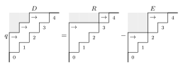
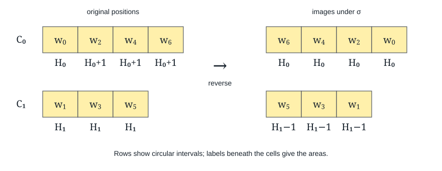

# The circular elementary expansion

We first prove the elementary expansion for a circular diagram. The
highest reachable vertex is defined on its integer cover. This allows the
local relations to pass through the chosen cut of the circle. When two
contact paths meet, we reverse consecutive intervals in their common
strict chain and reduce the area.

## Circular diagrams and highest reachable vertices

Let $n\geq1$, and let $(a_0,\ldots,a_{n-1})$ satisfy
$0\leq a_i<n$ and $a_{i+1}\leq a_i+1$, with subscripts modulo $n$.
We extend the sequence periodically and put $b(i)\coloneqq i-a_i$.
The natural edges in row $i$ are

\[
                 b(i)\longrightarrow i,\quad\ldots,\quad i-1\longrightarrow i.
\]

We identify integer translates by $n$. A natural edge retains its positive
lift, of length less than $n$. In particular, opposite edges between two
residues are distinct. The first edge in row $i$ is a corner when
$a_i>0$ and $b(i+1)>b(i)$. We may mark any subset $S$ of the corners
strict. We denote the resulting decorated diagram by $D$.

For a finite alphabet $X=(x_1,\ldots,x_m)$, define

\[
 G_D(X;q)\coloneqq
 \sum_{\substack{\kappa:\mathbb Z/n\mathbb Z\to\{1,\ldots,m\}\\
       uv\in S\Rightarrow\kappa(u)<\kappa(v)}}
 q^{\#\{uv\notin S:\kappa(u)<\kappa(v)\}}
 \prod_u x_{\kappa(u)}.
\]

A selected state $A$ contains all strict edges and any subset of the
remaining natural edges. We call $A$ admissible when its directed graph
on residues is acyclic. For an integer $u$, let

\[
 \widetilde H_A(u)\coloneqq
 \max\{v\in\mathbb Z:v\text{ is reachable from }u\text{ in the lift of }A\}.
\]

We allow paths of length zero. A path cannot repeat a residue, so this
maximum exists. Moreover, $\widetilde H_A(u+n)=\widetilde H_A(u)+n$.
Its residue defines a map $H_A$ on the vertices of the circular diagram.
Let $\lambda(A)$ be the partition of the sizes of its nonempty fibres,
and put

\[
 \widehat G_D(X;q)\coloneqq
 \sum_{A\text{ admissible}}q^{|A\setminus S|}e_{\lambda(A)}(X).
\]

For example, take $(a_0,a_1,a_2)=(1,1,1)$ with no strict corners.
The natural edges form the directed cycle $0\to1\to2\to0$.
The selected path $2\to0\to1$ lifts to $2\to3\to4$.
All three vertices therefore have highest reachable residue $1$.
The empty selection, the three single edges and the three two-edge
paths give

\[
 \widehat G_D(X;q)=e_1(X)^3+3q e_2(X)e_1(X)+3q^2e_3(X).
\]

**Circular expansion theorem.** For every circular decorated diagram,

\[
                 G_D(X;q+1)=\widehat G_D(X;q).
\]

Thus the shifted polynomial has nonnegative coefficients in the elementary
basis. The identity holds for every finite alphabet and hence
coefficientwise in infinitely many variables.

## The local reductions

Throughout the proof, $F_D$ denotes either of the two expressions in the
theorem. If a non-strict corner is deleted or marked strict, write the
result as $D^-$ or $D^{\mathrm s}$, respectively. We have

\[
                   F_D=F_{D^-}+qF_{D^{\mathrm s}}.                 \tag{1}
\]

For colorings, this is the expansion of the corner weight
$1+q\,\mathbf1_{\kappa(u)<\kappa(v)}$. For selected states, we split
according to whether the corner is selected. In the selected term its
strict marking preserves reachability and removes one factor $q$.

Every vertex has at most one incoming and one outgoing strict edge.
Consequently the strict graph consists of chains and cycles. A strict
cycle makes both expressions zero. If every natural edge is strict and
there is no cycle, both expressions are the product of $e_{|B|}(X)$
over the strict chains, including isolated vertices.

Write $s(i)$ for the strict flag in row $i$ and
$g(i)\coloneqq b(i+1)-b(i)-s(i)$ for the number of east steps after
that row. A bounce starts at a strict row $t$ with $a_t\geq2$ and
$g(t)>0$. Its first lower contact is $x=b(t)$. At a contact with
$g(x)=0$, the flags $s(x),s(x+1)$ specify NN, DN, ND or DD.
A DD contact continues the bounce backwards along the strict path.

The NN relation shortens the original terminal strict edge by one and
has coefficient $1+q$. The DN relation additionally moves the initial
strict head from $x$ to $x+1$ and has coefficient $1$. In path notation,

\[
 \begin{aligned}
 F_{U\mathrm{nn}V\mathrm{de}W}
   &=(1+q)F_{U\mathrm{nn}V\mathrm{ed}W},\\
 F_{U\mathrm{dn}V\mathrm{de}W}
   &=F_{U\mathrm{nd}V\mathrm{ed}W}.
 \end{aligned}                                                   \tag{2}
\]

Here the displayed steps specify the contact and terminal changes in the
integer lift; all periodic exterior data remain in place.

The coloring calculation pairs the two orders of the colors at $x,x+1$.
Boundary monotonicity exchanges their exterior incidences. For the
orientation calculation, consider a lifted triangle $P<Y<T$ with
$P\to T$ mandatory. With all other selected edges fixed, let $M_U$
be the HRV elementary monomial after adding
$U\subseteq\{P\to Y,Y\to T\}$, taking value zero for a cycle.
The four selections satisfy

\[
 M_{\{P\to Y\}}+M_{\{Y\to T\}}
       =M_\varnothing+M_{\{P\to Y,Y\to T\}}.                     \tag{3}
\]

Indeed, we distinguish $\widetilde H(Y)\leq\widetilde H(P)$ from
$\widetilde H(P)<\widetilde H(Y)$. In the first case adding $P\to Y$
does not change the bottom HRV map, and it does not change the map
after $Y\to T$ is added. In the second case the corresponding redundant
edge is $Y\to T$. The mandatory edge $P\to T$ gives the required
comparison with $\widetilde H(T)$. These pairings include the zero
terms arising from cyclic selections.

After inserting weights, (3) becomes

\[
 M_\varnothing+q(M_{\{P\to Y\}}+M_{\{Y\to T\}})
       +q^2M_{\{P\to Y,Y\to T\}}
 =(1+q)(M_\varnothing+qM_{\{P\to Y,Y\to T\}}).
\]

The bottom terms in (2) correspond under the periodic exchange of the
contact vertices; the top terms have the same transitive closure.
The exchange preserves order on sinks: its only inverted pairs are
$x+kn,x+1+kn$, and the first vertex has a mandatory outgoing edge.
Every reachable vertex extends to a sink. Thus the exchange transports
the highest reachable map and preserves its fibre sizes.

### Removing intervening DD contacts

We prove (2) by induction on the number of intervening DD contacts,
for both values of $F$ simultaneously. We assume the strict graph is
acyclic; strict cycles have already been treated. The case of no DD
contact is the local calculation above.

Suppose there is at least one DD contact. At the contact nearest the
terminal row $t$, put $p=b(t)$ and $u=b(p)$. Since $g(p)=0$ and both
$p,p+1$ are strict rows, the three strict edges there are

\[
             e:u\longrightarrow p,\qquad
             e':u+1\longrightarrow p+1,\qquad
             f:p\longrightarrow t.
\]

Write $h=a_p=a_{p+1}$ and $L=a_t$. We have $h,L\geq2$.
For $L$ this is terminal eligibility. For $h$, the corner at $p+1$
gives $b(p+2)>u+1$, while boundary monotonicity and $p+2\leq t$ give
$b(p+2)\leq b(t)=p$. Hence $u\leq p-2$.
In particular the five displayed integer vertices
are ordered $u<u+1<p<p+1<t$.

Unmark $e'$, then apply the direct DN relation to $e,f$; call the result
$R$. Alternatively, delete the corner $e'$ from $D$; call this diagram
$E$. Their changed rows are exactly as follows. An entry is the pair
$(\text{area},\text{strict flag})$; all other rows stay fixed.

| Diagram | Row $p$ | Row $p+1$ | Row $t$ |
| --- | --- | --- | --- |
| $D$ | $(h,1)$ | $(h,1)$ | $(L,1)$ |
| $R$ | $(h,0)$ | $(h+1,1)$ | $(L-1,1)$ |
| $E$ | $(h,1)$ | $(h-1,0)$ | $(L,1)$ |

Unmarking and deleting $e'$, followed by the direct DN identity, give

\[
                         qF_D=F_R-F_E.                         \tag{DD1}
\]

*Figure 1.* We illustrate (DD1) with areas $(0,1,2,2,2)$ and strict
corners $02,13,24$. Thus $p=2$ and $t=4$. The resolved diagram has
areas $(0,1,2,3,1)$ and strict corners $03,34$; the deletion diagram
has areas $(0,1,2,1,2)$ and strict corners $02,24$. Each diagram sums
over all optional cells with weight $q^{|A\setminus S|}$. For the HRV
value we sum only admissible states; equivalently cyclic states have
value zero. For the coloring value we use the selected-edge expansion
of $G_D(X;q+1)$.

The new terminal row is $p+1$ in $R$ and $p$ in $E$. Both have a
positive east gap. In $E$, deleting $e'$ raises $b(p+1)$ by one, so the
gap after $p$ becomes positive. In $R$, the new boundary at $p+1$
is $u$, whereas the following boundary is greater than $u+1$.
The new terminal areas are $h+1$ and $h$, both at least two.
Moreover,

\[
                    b_R(p+1)=u=b_E(p).
\]

Thus both child bounces resume at the next old contact. Every subsequent
contact and its two flags stay unchanged, so each child has one fewer
DD contact and the same final NN or DN contact. Here the final flag
$s(x+1)=0$ is essential: following the two strict predecessor paths
cannot identify a later contact with one of the changed rows without
producing a strict cycle or making $x+1$ strict. The deleted strict
graph is a subgraph of the source. The resolved strict graph is obtained
from the source with $e'$ removed by exchanging $p,p+1$ periodically;
it too is acyclic. The induction therefore applies to both children.

Let $T$ be the target required by (2) for $D$, and put $\gamma=1+q$
in the NN case and $\gamma=1$ in the DN case. In $T$, the old edge
$e$ is still a strict corner. Let $U$ unmark this corner of $T$, and
let $W$ delete it. The target for the child $R$ is exactly $U$.
The target for $E$ becomes $W$ after one direct DN move at $p,t$.
We can see both assertions from the rows:

| Diagram | Row $p$ | Row $p+1$ | Row $t$ |
| --- | --- | --- | --- |
| $T$ | $(h,1)$ | $(h,1)$ | $(L-1,1)$ |
| $U$ | $(h,0)$ | $(h,1)$ | $(L-1,1)$ |
| Target of $E$ | $(h-1,1)$ | $(h-1,0)$ | $(L,1)$ |
| $W$ | $(h-1,0)$ | $(h,1)$ | $(L-1,1)$ |

In the DN case every diagram in this table also includes the same changes
at the initial contact: increase $a_{x+1}$ by one and move the strict
head from $x$ to $x+1$. The strict path from $x$ through $p$ to $t$
cannot repeat a residue, and $p+1$ has no outgoing strict edge by the
terminal east gap.
Thus $x$ differs from all three displayed residues. The non-strict row
$x+1$ differs from them because all three are strict in the source.
In the NN case there are no additional changes.

The two shorter-contact relations, and the final direct DN move on the
deletion side, now give

\[
             F_R=\gamma F_U,\qquad F_E=\gamma F_W.
\]

Substitution into (DD1), followed by the corner relation at $e$ in $T$,
gives

\[
       qF_D=\gamma(F_U-F_W)=q\gamma F_T.
\]

We cancel $q$ in the polynomial ring and obtain (2). This is an
induction on the number of contacts. In fact $R$ has the same area
sum as $D$ but one fewer strict edge, so its doubled area is one
larger; the outer area induction is not used for this intermediate.

### Separated ND contacts

For an ND contact whose two strict paths are disjoint, the same
unmarking and deletion argument gives

\[
                        F_D=qF_Q+(1+q)F_R,                       \tag{4}
\]

where $Q$ shortens the terminal strict edge and $R$ also moves the
initial strict head from $x+1$ to $x$. The separation condition ensures
that these row changes are distinct. We next treat contacts whose
paths meet.

## A contact at the terminal vertex

First suppose that $x+1$ has the residue of the terminal vertex $t$.
Write the lower contacts as $p_0,\ldots,p_{r-1}$, in forward strict
order, and put $q_i=p_i+1$ modulo $n$. The strict chain is

\[
 p_0\to\cdots\to p_{r-1}\to q_0\to\cdots\to q_{r-1},
 \qquad q_0=t\pmod n.
\]

The paired vertices are distinct, and $r\geq2$. Exchange each $p_i$
with $q_i$. The target strict chain becomes
$q_0\to\cdots\to q_{r-1}\to p_0\to\cdots\to p_{r-1}$.
We decrease the area at $p_0$ by one and that at $q_0$ by two,
replace the strict corner into $q_0$ by the new corner into $p_0$,
and retain every other strict edge. The initial equal boundaries and
the terminal east gap give a valid diagram $Q$.

The exceptional non-strict pairs are

\[
 \begin{aligned}
 B&=\{p_iq_i:0\leq i<r\},\\
 C&=\{q_{i-1}p_i:1\leq i<r\},\\
 T&=\{p_{r-1}p_0,q_{r-1}p_0,q_{r-1}q_0\}.
 \end{aligned}
\]

In the source, the $r$ edges of $B$ follow the strict chain, while
$C\cup T$ opposes it. In the target, the $r-1$ edges of $C$ follow
the chain, $B$ opposes it, and the three pairs in $T$ have been removed.
After these pairs are removed, the periodic exchange identifies the
remaining lifted graphs and preserves sink order. Relabeling colorings
and highest reachable vertices therefore identifies the residual sums.
Following edges contribute $1+q$ and opposing edges contribute $1$,
which gives

\[
                            F_D=(1+q)F_Q.                       \tag{5}
\]

The strict-edge count is unchanged and the area decreases by three.
Thus this case reduces the doubled area by six.

## Reversing the columns of a strict chain

At an overlapping ND contact, the two strict paths combine into one
whole strict chain. We write its vertices in chain order as

\[
 w_0\longrightarrow w_1\longrightarrow\cdots
       \longrightarrow w_{r+j-1},\qquad
 w_a+1=w_{a+j}\pmod n\quad(0\leq a<r).                          \tag{6}
\]

Here $w_0$ is the initial main contact, $w_r$ is the terminal vertex,
and $2\leq j<r$. Uniqueness of strict predecessors and successors
propagates the first interior intersection to (6). The ND flag gives a free
initial vertex, and the terminal east gap gives a free final vertex,
so the chain is a whole strict component. The case $j=1$ would make
the terminal strict edge have length one, contrary to $a_t\geq2$.
The case $j=r$ is the terminal contact treated above.

Write $r=dj+s$, where $0\leq s<j$, and form the columns

\[
 C_c=(w_c,w_{c+j},w_{c+2j},\ldots),\qquad
 \ell_c=d+1+\mathbf1_{c<s}\quad(0\leq c<j).
\]

Each column is a consecutive circular interval. The columns are disjoint,
although their subscripts need not be in circular order. Let $H_c$ be
the positive circular distance from the first vertex of $C_{c-1}$ to
the first vertex of $C_c$, with column subscripts modulo $j$.
Then $H_c\geq\ell_{c-1}\geq2$. The areas in $C_c$ are all $H_c$
for $c>0$; in $C_0$ they are $H_0,H_0+1,\ldots,H_0+1$.

Reverse each column, fixing all other vertices, and call this permutation
$\sigma$. Apply it periodically on the integer cover. We obtain a
new diagram $Q$ by transporting the strict edges and setting the areas
as follows:

- if $s=0$, every area in $C_0$ becomes $H_0-1$;
- if $s>0$, every area in $C_0$ becomes $H_0$, and every area in
  $C_s$ decreases by one;
- all other areas remain unchanged.

*Figure 2.* We take $r=5$ and $j=2$, so the strict chain is
$w_0\to\cdots\to w_6$. Each row is a consecutive circular interval,
drawn in circular order. The permutation reverses the entries within
each row. The rows need not be adjacent on the circle. Strict edges
in the new diagram are the images of the original chain edges.

At a strict head in $C_c$, $c>0$, the transported edge has length
$H_c+\ell_c-\ell_{c-1}$. At a strict head in $C_0$, its length is
$H_0+\ell_0-\ell_{j-1}-1$. These are the prescribed new areas.
Within each column the new boundary increases by one. At its endpoint,
a positive area decrement can occur only at the old terminal vertex
or at the new non-strict head. The terminal east gap absorbs the
former decrement; the latter needs only a nonnegative gap.
Thus the cyclic area inequalities and all strict-corner conditions hold.
No area increases, the strict-edge count is unchanged, and the total
area decreases by $2d+1$ if $s=0$, or by $2d+2$ if $s>0$.

To compare the two expressions, remove all non-strict edges internal to
the displayed strict component in both diagrams. An internal edge
following the strict-chain order always ascends in a strict coloring.
Its selection does not change the circular HRV map. It therefore
contributes a factor $1+q$ to both expressions. An internal edge
opposing that order never ascends, and its selection creates a cycle;
it contributes no factor.

For the HRV assertion, lift an internal forward edge to $u\to v$.
The strict path from its tail residue to its head residue ends at
$v+kn$ for some $k\geq0$. Hence
$\widetilde H(v)+kn\leq\widetilde H(u)$, and adding $u\to v$
cannot increase any highest reachable value.

The two residual lifted graphs are conjugate by $\sigma$. To check
exterior incidences, observe that an incoming interval from an exterior
head contains a whole column or misses it: strict-successor uniqueness
and boundary monotonicity exclude an endpoint inside the column.
At the strict sink the boundary value is skipped by the terminal gap.
For a head inside the component, the changed lower endpoint lies in
the preceding column or just after it, so only internal edges change.

Relabeling colors now identifies the residual coloring sums. For the
orientation sums, every selected sink is a strict sink. The moved
component has just one strict sink, which stays in its column; all
other strict sinks are fixed. Consequently $\sigma$ preserves the
order of integer sink lifts and transports highest reachable vertices.
It identifies the residual HRV sums as well.

Let $f_D,f_Q$ be the numbers of deleted edges following strict-chain
order in the respective diagrams. There are common residual expressions
$C,E$ with

\[
 \begin{aligned}
 G_D(X;q+1)&=(1+q)^{f_D}C,&\widehat G_D(X;q)&=(1+q)^{f_D}E,\\
 G_Q(X;q+1)&=(1+q)^{f_Q}C,&\widehat G_Q(X;q)&=(1+q)^{f_Q}E.
 \end{aligned}
\]

The equality for $Q$ gives $C=E$ by cancellation of $(1+q)^{f_Q}$,
and hence gives the equality for $D$.

## Completing the induction

Set

\[
 A_2(D)\coloneqq2\sum_i a_i-|S|,
 \qquad
 J(D)\coloneqq\sum_{e\in S}d(\operatorname{head}(e))\ell(e),
\]

where $\ell(e)$ is the positive circular length of $e$ and $d(v)$
is the number of proper strict ancestors of $v$. We induct lexicographically
on $(A_2(D),J(D))$, treating strict cycles as zero cases.

A non-strict corner gives (1); deletion decreases $A_2$ by two,
and strict marking decreases it by one. We may therefore suppose
all corners are strict. If no non-strict edge remains, the chain
product proves the theorem.

Otherwise some area is at least two. A positive constant area sequence
with every corner strict would give a strict cycle. An exit from a
plateau of maximal area therefore supplies an eligible terminal row.
At a lower contact with a positive east gap, restart there. At a DD
contact continue backwards. Every step follows an actual strict edge
backwards and decreases the number of strict ancestors. The search
therefore ends at NN, DN or ND.

For NN, (2) decreases $A_2$ by two. For DN it preserves $A_2$ and
decreases $J$: the exchange conjugates the strict paths and preserves
ancestor depths, while the initial edge length increases by one and
the terminal edge length decreases by one. Thus the change in $J$ is
$d(p_0)-d(t)<0$, where $p_0$ and $t$ are the initial and terminal
vertices on the longer strict path. For separated ND, the targets in
(4) decrease $A_2$ by two and four. An ND contact at the terminal vertex
uses (5), decreasing $A_2$ by six. For an interior intersection, column
reversal strictly decreases $A_2$, and the residual comparison transfers
the identity from the smaller diagram. These cases prove the theorem.
