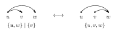

# Introduction

The elementary expansion of a vertical-strip LLT polynomial can be read
from directed paths in its natural unit-interval graph. We retain every
strict edge and choose a subset of the normal edges. The highest vertex
reachable from each vertex determines a set partition, and the sizes of
its blocks give an elementary symmetric function. The formula of
P. Alexandersson and R. Sulzgruber [@AS22] expresses the LLT polynomial
after $q\mapsto q+1$ as the sum of these terms, weighted by the number
of chosen normal edges.
We extend this formula to circular diagrams and prove that it holds
separately on every component under local triangle flips.

LLT polynomials are closely related to chromatic quasisymmetric functions.
For an ordinary natural unit-interval graph $D$ without strict edges, the
unicellular LLT polynomial $G_D(X;q)$ sums $q^{\operatorname{asc}(\kappa)}x_\kappa$
over all vertex colorings, whereas the chromatic quasisymmetric function
$X_D(X;q)$ restricts this sum to proper colorings. Here an ascent is an edge
$u\to v$ with $\kappa(u)<\kappa(v)$, and
$x_\kappa=\prod_u x_{\kappa(u)}$. The plethystic identity

\[
 X_D(X;q)=(q-1)^{-n}G_D[(q-1)X;q]
 \tag{chromatic}
\]

relates the two functions on $n$ vertices [@AS22, Lemma 6.17]. The brackets
denote plethysm in the alphabet: on the power sums,
$p_r[(q-1)X]=(q^r-1)p_r(X)$. In particular, the Dyck-path bounce relations
and multiplicativity are the same for the two families; their initial
values on path graphs differ [@AS22, Corollary 6.18]. This common recursion
explains why diagram identities for LLT polynomials also arise in the
study of chromatic quasisymmetric functions.

A component refinement also arises on the chromatic side.
B.-H. Hwang [@Hwa22, Section 3] partitions heaps associated with proper
colorings into classes under local flips. A flip reverses a two-edge
fork whose edges are covers. These classes refine the ascent statistic
[@Hwa22, Proposition 3.7],
and their chromatic contributions are symmetric and Schur-positive
[@Hwa22, Theorems 3.8 and 4.19]. Hwang conjectures elementary positivity
for these contributions; in his weak-coloring convention this is stated
as complete homogeneous positivity [@Hwa22, Conjecture 3.10]. He also
asks for an analogous positive refinement of LLT polynomials
[@Hwa22, Section 5.3]. Our component theorem gives an elementary
expansion for the LLT triangle-flip components defined below.
These flips act on selected edges of the natural diagram, while Hwang's
flips act on heaps of proper colorings.

We first treat the circular extension. Let $D$ be a circular diagram with
strict-edge set $S$. A selected state $A$ contains $S$ and any set of normal
edges; we call it \defin{admissible} when its directed graph on the residues
has no cycle.
There is no largest vertex on the circle, so for an admissible state we lift
its selected edges to the integers, take the greatest reachable integer, and
reduce modulo the period. The resulting fibre sizes form a partition
$\lambda(A)$. Our first result is the following. It requires a direct LLT
argument, since the ordinary plethystic identity (chromatic) fails in the
circular setting [@AS22, Section 6.8].

::: {.theorem #thm:introCircular title="Circular elementary expansion"}
For every circular decorated diagram $D$,

\[
 G_D(X;q+1)=
 \sum_{A\text{ admissible}}q^{|A\setminus S|}e_{\lambda(A)}(X),
\]

where $\lambda(A)$ consists of the sizes of the fibres of the highest
reachable map on the circle. Thus the coefficient of $e_\lambda(X)$ counts
admissible selected states with fibre-size partition $\lambda$, with the
weight $q^{|A\setminus S|}$.
:::

Our second result refines the expansion component by component, for ordinary
and circular diagrams alike. We give the flip precisely before stating it.

::: {.definition #def:introFlip title="Selected-edge flips"}
An edge in a selected state is a \defin{cover} when there is no selected path
between its endpoints with an intermediate vertex. Choose three vertices
$u<v<w$ for an ordinary diagram, or three integer lifts
$u<v<w<u+n$ for a circular diagram, and suppose all three edges of this
triangle are natural. Suppose that the long edge $uw$ and one short edge $uv$
are selected, while the other short edge $vw$ is not.
A \defin{flip} replaces $uv$ by $vw$, retaining $uw$ and every other
selected edge, when $uv$ and $uw$ are covers before the replacement and $uw$
and $vw$ are covers afterwards. The exchanged short edges are normal, so all
strict edges are retained. In the circular case, both states must be
admissible, and the cover tests are made on the integer lift.
:::

::: {.example #ex:introFlip title="The smallest flip"}
In a triangle on $u<v<w$ with no strict edges, the state

\[
                         \{uv,uw\}\longmapsto\{uw,vw\}
\]

is a flip: before and after the move, the two selected edges are
covers. Thus a flip keeps the long edge and moves the selected short edge
across the triangle.
:::

*Figure 1.* The two states in the smallest flip. Arrows are selected edges.
The labels give the fibres of the highest-reachable map.

Flips partition the admissible selected states into components. For a
selected state $A$, let $\mathsf{K}(A;X)$ be the sum of monomials over colorings that
increase strictly along every selected edge.

::: {.theorem #thm:introComponent title="Component elementary expansion"}
For every ordinary or circular decorated diagram and every flip component
$C$ of selected states, restricting in the circular case to admissible states,

\[
                  \sum_{A\in C}\mathsf{K}(A;X)
                    =\sum_{A\in C}e_{\lambda(A)}(X).
\]
:::

In particular, the colorings become symmetric after summing over one
component. The coefficient of $e_\lambda$ is the number of states in $C$
whose highest-reachable fibres have sizes $\lambda$. A flip preserves the
number of selected normal edges, so multiplying by the common power of $q$
gives the component's contribution to the shifted LLT polynomial.

For the triangle in Example~\ref{ex:introFlip}, the two displayed states form
one component $C$. The left state has highest-reachable fibres
$\{u,w\}$ and $\{v\}$, while the right state has the single fibre
$\{u,v,w\}$. The component theorem therefore gives

\[
                         \mathsf{K}(C;X)=e_2(X)e_1(X)+e_3(X).
\]

Both states select two normal edges, so their shifted contribution is

\[
                         q^2\bigl(e_2(X)e_1(X)+e_3(X)\bigr).
\]

This positivity is a refinement of the LLT expansion. Applying the
ordinary plethystic transformation does not give positive chromatic
contributions term by term: already
$(q-1)^{-1}e_2[(q-1)X]=(q+1)e_2(X)-e_1(X)^2$.
Thus the common diagram relations and the two component constructions
provide related approaches to positivity, while the generating functions
and local moves remain distinct.

We follow the diagram method of [@AS22], proving the required local
identities in the circular setting. The resulting argument recovers their
ordinary elementary expansion as a special case, without assuming their
expansion or uniqueness theorem. The component theorem further refines
this identity, both for ordinary and for circular diagrams.

The two proofs have a common starting point. We use diagrams to describe
sums over selections. Blank cells
are optional edges; selected, absent and strict entries impose the
corresponding restrictions. A local identity can therefore retain all
exterior choices. The four relations, namely corner resolution and the NN,
DN, and ND bounce relations, are collected in
Proposition~\ref{prop:fourRecurrences}. We prove that the coloring and
highest reachable sums satisfy each relation. In the first part, these
identities reduce both sums to the same products of elementary functions
on strict chains. The circular obstruction is that bounce paths may
intersect. Reversing consecutive intervals in their common strict chain
and removing internal edges with known factors reduces these intersections
to smaller diagrams as well.

For ordinary components, we need actual paths of flips as well as
identities between sums. Starting from a state in which every corner is
a cover, we prepare its selected edges and use crossing slides to
rearrange them while restoring the exterior. These paths show that the
relevant connected states of each selected size lie in one component.
We can then complete a component
to a full edge layer, apply a diagram relation, and subtract the other
components using smaller diagrams. Fixing the color at an endpoint
allows the recurrence to be attached to the rest of the diagram.

To pass to circular components, we expand a selected graph into balanced
subgraphs, whose edge lengths are differences of a vertex potential.
The same signed coefficients work for the coloring and HRV values, and
remain constant along flip components. Sorting compatible lifts
then represents each balanced circular component by a union of ordinary
components. This reduces the circular statement to the ordinary diagram
proof.

The final application is to LLT cumulants. Their defining alternating sum
over set partitions retains precisely those selected graphs which connect
the prescribed vertex classes. This is the connected-subgraph principle
of M. Dołęga and M. Kowalski [@DK22, Theorem 3.8]. Connectivity is constant
on a flip component, so the component theorem applies to the retained
terms. Corollary~\ref{cor:cumulantComponent} gives the circular cumulant
expansion and refines its ordinary counterpart [@DK22, Theorem 3.17]
component by component.

Section~\ref{c-the-circular-elementary-expansion} proves the circular
expansion from the four diagram relations. Section~\ref{o-ordinary-component-expansions}
uses these relations to prove the ordinary component theorem, isolating the
connectivity statement needed for its recurrence. We prove that statement
by explicit paths of flips in Section~\ref{f-connecting-states-by-flips}.
Section~\ref{cc-circular-component-expansions} then passes from ordinary to
circular components, and Section~\ref{k-llt-cumulants} derives the cumulant
corollary. Throughout we use a finite alphabet
$X=(x_1,\dotsc,x_m)$ and write

\[
 e_r(X)=\sum_{1\leq i_1<\dotsb<i_r\leq m}x_{i_1}\dotsm x_{i_r},
 \qquad e_0(X)=1,
 \qquad e_\lambda(X)=\prod_j e_{\lambda_j}(X).
\]

The identities hold for every alphabet size and therefore give the
corresponding symmetric-function identities.
