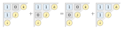
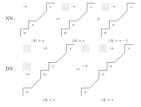
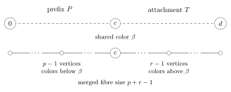
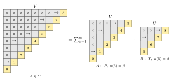

# Ordinary component expansions

We now refine the expansion to flip components. We first treat ordinary
diagrams, applying the corner and NN/DN relations from the
[circular proof](CIRCULAR_E_EXPANSION.md#the-local-reductions) to complete edge
layers and then isolating one component. The main step is to connect the states in which every
maximal corner is a cover. We then complete such a component to an entire
edge layer, apply the local relation, and remove the additional components by
induction. An endpoint attachment extends this construction to diagrams with
articulations. We state the needed connectivity lemma here and prove it
by explicit flips in Section~\ref{f-connecting-states-by-flips}. The circular
case is treated in Section~\ref{cc-circular-component-expansions}.

## Colorings, highest reachable vertices, and flips

::: {.definition #def:ordinarySelectedDiagrams title="Selected diagrams and their values"}

Let $D$ be an ordinary decorated natural diagram on $0,\ldots,n-1$.
Its area sequence satisfies $a_0=0$, $0\leq a_j\leq j$ and
$a_{j+1}\leq a_j+1$. The natural edges ending at $j$ are $ij$ with
$j-a_j\leq i<j$. A natural corner is an edge whose interval is contained in no larger
natural interval. We may mark any subset of these corners strict.
A state $A$ is a selection of natural edges containing every strict edge.
All edges point from the smaller vertex to the larger vertex. For a finite
alphabet $X=(x_1,\ldots,x_m)$, we put

\[
 \mathsf{K}(A;X)\coloneqq
 \sum_{\substack{\kappa:\{0,\ldots,n-1\}\to\{1,\ldots,m\}\\
                    uv\in A\Rightarrow\kappa(u)<\kappa(v)}}
 \prod_{u=0}^{n-1}x_{\kappa(u)}.
\]

Let $H_A(u)$ be the greatest vertex reachable from $u$, allowing the path
of length zero. Write $\lambda(A)$ for the partition of the nonempty fibre
sizes of $H_A$, and put $\mathsf{E}(A;X)\coloneqq e_{\lambda(A)}(X)$.
Equivalently, we obtain $\mathsf{E}(A;X)$ by replacing every fibre by its increasing
chain and enumerating its strict colorings. We use this chain description
when a vertex color is fixed.
:::

::: {.definition #def:ordinaryFlip title="Flips and flip components"}
A selected edge $uv$ is a cover if there is no selected path from $u$
to $v$ with an intermediate vertex. For $i<j<k$, a flip exchanges
$ij$ and $jk$, retaining $ik$ and every other selected edge. We require
$ij,ik$ to be covers before the exchange and $ik,jk$ to be covers
afterwards. Both exchanged edges are non-strict. The flip components
are the connected components under these moves.
:::

::: {.lemma #lem:flipInvariants title="Flip invariants"}
A flip preserves the number of selected edges and the selected weak
blocks.
:::

::: {.proof}
The retained long edge joins $i$ to $k$, and either
short edge joins $j$ to that same block. A maximal natural corner
cannot be exchanged as a short edge, since it would then lie properly
inside the retained long edge. Its selected status is therefore
constant on each component.
:::

::: {.definition #def:ordinaryComponentValues title="Component values"}
For a flip component $C$, we sum either value over its states:
$\mathsf{K}(C;X)=\sum_{A\in C}\mathsf{K}(A;X)$ and
$\mathsf{E}(C;X)=\sum_{A\in C}\mathsf{E}(A;X)$.
:::

::: {.theorem #thm:ordinaryComponent title="Ordinary component identity"}
For every ordinary decorated natural diagram and every whole
flip component $C$, we have

\[
                     \mathsf{K}(C;X)=\mathsf{E}(C;X).
\]
:::

::: {.corollary #cor:ordinaryComponentShift title="Shifted component contribution"}
Expanding each normal-edge weight after the shift gives

\[
 G_D(X;q+1)
     =\sum_A q^{|A\setminus S|}\mathsf{K}(A;X),
\]

where $S$ is the original strict set and $A$ runs over all selected states.
The number $k(C)$ of selected normal edges is constant on a flip component.
Consequently its contribution to the LLT polynomial after the shift
$q\mapsto q+1$ is

\[
                q^{k(C)}\sum_{A\in C}e_{\lambda(A)}(X).
\]
:::

## Proof strategy

We induct on the number of vertices, the total natural area, and the area
moment $\sum_i i a_i$, in that order. The area here counts all natural
edges. The proof of the recurrence has four steps.

1. If a component omits a corner, has a disconnected selected graph, or has
   no state in which all corners are covers, we express its two values in
   terms of components of smaller diagrams. The coefficients agree for
   the coloring value and the elementary value.
2. In the remaining case, the connectivity lemma identifies one component
   containing all connected states of the required size with corner
   covers. We add the other components to obtain the entire edge layer.
3. We apply NN or forward DN to that layer and subtract the smaller
   components added in the previous step. NN decreases natural area;
   forward DN preserves area and moves a natural edge from a later row to
   an earlier row, decreasing $\sum_i i a_i$.
4. If the diagram has articulations, we apply this recurrence to the first
   nontrivial block and its preceding path. Fixing the color at the shared
   endpoint lets us attach the unchanged remainder to every term.

The final induction uses only the resulting smaller components. In an ND
or DD contact we first unmark the obstructing corner: it remains selected
throughout the chosen component, so its states and both values are
unchanged. This makes the contact NN or DN without invoking induction.
Thus the component proof uses the same diagram relations, directed by
area and area moment, and not an assumption that one local move sends a
component to a component. The connectivity proof is given separately in
Section~\ref{f-connecting-states-by-flips} so that its exact role is visible
before its construction.

## Local moves and the diamond identity

We use cell diagrams to denote sums over selected states satisfying the
displayed restrictions. The diagonal lists the ordered vertices. White cells lie inside the natural
diagram; gray lies outside it.
A blank white cell permits either selection, $1$ requires a selected normal
edge, and $0$ requires it absent. Zigzags along the diagonal indicate
arbitrary intervening vertices; consecutive vertices have adjacent steps.
An arrow denotes a strict edge. Underlining a selected entry additionally
requires a cover in the full selected relation. Conditions below a diagram
restrict the entire sum, for example to $|A|=s$.
All cells in this section are unweighted. The surrounding statement fixes
$V=\mathsf{K}$ or $V=\mathsf{E}$ and specifies whether the exterior selection is fixed or
summed. With every selection fixed, the diagram gives one state value.

We next use a relation between values of states. Fix a forward
selected relation $B$ containing $ik$ and omitting $ij,jk$.

::: {.lemma #lem:ordinaryDiamond title="Diamond identity"}
For $V=\mathsf{K},\mathsf{E}$, we have

\[
                  V(B\cup\{ij\})+V(B\cup\{jk\})=V(B)+V(B\cup\{ij,jk\}).
                  \tag{D}
\]

The identity also holds with the color of any specified vertex fixed.
There are no cover hypotheses, and the exterior selected edges are arbitrary.
:::

*Figure 1.* Each off-diagonal cell records whether the corresponding
natural edge is selected. The long edge $ik$ is retained in all four
states. Equation (D) holds even when the two middle states are not
joined by a flip.

::: {.proof}
For a coloring strict on $B$, write its colors at $i,j,k$ as
$a,b,c$. Since $a<c$, we have

\[
             \mathbf1_{a<b}+\mathbf1_{b<c}
                 =1+\mathbf1_{a<b<c}.
\]

Multiplication by the coloring monomial and summation prove the $\mathsf{K}$
identity, including any prescribed vertex color.

For $\mathsf{E}$, we pair the four states in Figure 1 so that paired states have
the same entire highest reachable map.

Adding $uv$ leaves the entire highest reachable map unchanged whenever
$H_B(u)\geq H_B(v)$. A new path using $uv$ can reach only an old
descendant of $v$, and every old predecessor of $u$ already reaches a
vertex at least as large as $H_B(v)$.

If $H_B(j)\geq H_B(k)$, adding $jk$ is therefore ineffective in $B$.
It is also ineffective in $B\cup\{ij\}$, since the earlier edge $ij$
changes no path starting at $j$ or $k$. Thus the state with only $jk$
added pairs with $B$, and the state with both edges added pairs with the
state with only $ij$ added.
If $H_B(j)<H_B(k)$, the retained $ik$ gives
$H_B(i)\geq H_B(k)>H_B(j)$. Adding $ij$ is ineffective both before
and after $jk$ is added. This gives the other pairing. Equal maps have
equal canonical fibre chains, proving the marked $\mathsf{E}$ identity as well.

We will also delete a redundant selected edge when a selected alternate
path between its endpoints remains. This preserves the transitive closure,
so it preserves the coloring constraints, the highest reachable map,
and their marked values.
:::

## Three reductions to smaller components

We write $M$ for the maximal natural corners. The following reductions
apply to components; their coefficients are the same for $\mathsf{K}$ and $\mathsf{E}$.

::: {.lemma #lem:absentCorner title="Absent corner reduction"}
Suppose a state of a component $C$ omits $f\in M$.
Then every state of $C$ omits $f$, and $C$ is exactly one component
of the diagram with $f$ deleted; the corresponding $\mathsf{K}$ and $\mathsf{E}$ values are
preserved.
:::

::: {.proof}
Every state of $C$ then omits $f$. Delete $f$ from the natural diagram.
The selected relations and their cover tests are unchanged, and no flip
of $C$ can use the absent edge as its retained long. Conversely, every
flip of the smaller diagram lifts. Thus $C$ is exactly one whole
component of a diagram with one fewer natural edge.
:::

::: {.lemma #lem:disconnectedSelectedGraph title="Disconnected selected graph reduction"}
Suppose the natural graph is connected
but the selected weak graph of $C$ is disconnected. Its weak blocks are
constant throughout $C$.
Reordering these blocks into consecutive intervals gives one component
of a diagram with strictly smaller natural area, preserving $\mathsf{K}$ and $\mathsf{E}$;
when the greatest vertex has a fixed color, the reordering fixes it.
:::

::: {.proof}
Put these blocks in consecutive intervals,
preserving the vertex order inside each block, and keep the induced
natural diagram on each block. At least one natural edge between blocks
is lost, so natural area strictly decreases.

Every selected edge and every flip stays inside a weak block. Paths
between vertices of that block stay there as well, so restriction and
relabeling preserve all cover tests. The inverse relabeling has the same
property. Consequently the resulting states form one component.
Color relabeling preserves $\mathsf{K}$. Since the order inside every block is
preserved, the sizes of all highest reachable fibres are unchanged, so
$\mathsf{E}$ is preserved too. When the greatest vertex has a fixed color, we
put its weak block last. The relabeling then fixes that vertex.
:::

::: {.lemma #lem:noSimultaneousCornerCovers title="No simultaneous corner covers"}
Suppose every corner in $M$ is
selected throughout $C$, but no state has all of them covering
simultaneously.
After marking all corners strict, for every $T\subseteq M$ the image of
$C$ is a disjoint union of components in the diagram with $T$ deleted;
write this partition as $\mathcal P_T(C)$. For $V=\mathsf{K},\mathsf{E}$,

\[
 V(C)=\sum_{\varnothing\ne T\subseteq M}(-1)^{|T|+1}
                   \sum_{C'\in\mathcal P_T(C)}V(C').              \tag{C}
\]

Every component on the right has strictly smaller natural area, and the
identity remains valid with a fixed vertex color.
:::

::: {.proof}
First mark all corners in $M$ strict. This preserves
the component: corners cannot be exchanged, and their strict
marking changes neither the full selected relations nor their cover tests.

For $T\subseteq M$, delete the corners in $T$. We identify states in
these diagrams by their unchanged normal selections. The smaller flip
graph is a spanning subgraph of the original one: exactly the flips
retaining a deleted corner as their long edge are removed. Indeed, an
alternate path testing another natural edge lies inside its interval;
it cannot use a distinct maximal interval. Thus the image of $C$ is a
disjoint union of whole deletion components. Denote this partition by
$\mathcal P_T(C)$.

Fix a state $A\in C$ and choose one redundant corner $f\in M$.
Its alternate path lies strictly inside its interval and uses no other
maximal corner. It survives deletion of every subset of $M\setminus\{f\}$.
For $V=\mathsf{K},\mathsf{E}$, pair subsets $T$ and $T\cup\{f\}$ to obtain

\[
                  \sum_{T\subseteq M}(-1)^{|T|}V(A\setminus T)=0.
\]

The redundant corner may depend on $A$. Summing over $C$ and isolating
the empty deletion gives (C).

Each component on the right belongs to a diagram with strictly fewer
natural edges. The cancellation preserves the full highest reachable
map and all coloring constraints, so (C) also holds with a fixed vertex
color. We keep this identity unweighted: the original normal-edge exponent
is restored only after the component identity, since remarking changes it.
:::

::: {.lemma #lem:selectedIntervalEnvelope title="Deleting unused natural edges"}
Let $H$ consist of every natural interval contained in some selected
interval. Repeated deletion of absent maximal corners transforms the
ambient diagram to $H$ while preserving the component. The resulting
diagram is valid, every maximal interval of $H$ is selected, and its corners
may be marked strict; each proper deletion lowers natural area.
:::

::: {.proof}
Let $H$ consist of every natural interval contained in some selected
interval. A flip exchanges shorts inside a retained long, so $H$ is
constant on $C$. If the ambient diagram has an edge outside $H$, choose
a maximal natural interval containing it. This interval is also outside
$H$, hence is an absent corner. Delete it and repeat. The process ends
at the valid natural diagram $H$, preserving the component at
every step. Every maximal interval of $H$ is selected, since an interval
generating it must equal it by maximality. We may therefore mark all
its corners strict. Proper deletion reduces natural area; changing the
strict markings is only a new representation of the same selected states.
:::

## Connectivity needed for the recurrence

After the three reductions, we must isolate the component containing the
connected states in which every corner is a cover. We use the following
connectivity statement; its proof by flips occupies
Section~\ref{f-connecting-states-by-flips}.

::: {.lemma #lem:commonCoverUniqueness title="Connectivity with corner covers"}
Suppose an ordinary natural diagram is an initial path attached at its last
vertex to a connected diagram without an articulation. The initial path may
have length zero. Any two connected selected states with every maximal
corner a cover and with the same number of selected edges lie in one flip
component.
:::

## Completing one component to an edge layer

::: {.definition #def:ordinaryLayer title="Selected edge layers"}
Let $\mathcal L_s(D)$ denote all states with exactly $s$ selected edges,
including the strict edges. Each layer is a disjoint union of whole
components.
:::

We first apply the diagram relations to the entire layer, then use the
smaller-component reductions to isolate the required component.

::: {.proposition #prop:layerRelations title="NN and DN layer relations"}
Let $D\longmapsto R$ be an eligible NN or DN reduction in
Proposition~\ref{prop:fourRecurrences}. For every integer $s$ and
$V=\mathsf{K},\mathsf{E}$, the respective layer identities are

\[
 V(\mathcal L_s(D))
   =V(\mathcal L_s(R))+V(\mathcal L_{s-1}(R)).          \tag{LNN}
\]

and

\[
                    V(\mathcal L_s(D))=V(\mathcal L_s(R)).       \tag{LDN}
\]
:::

::: {.proof}
At an eligible NN contact, write $w<x=w+1<z$, with $wz$ strict.
The target $R$ deletes $wz$ and marks $xz$ strict. An exterior selection
$\eta$ contains the required strict exterior edges and is disjoint from all
displayed local edges. For each exterior selection, the source has the mandatory edge $wz$
and the two optional short edges $wx,xz$. The target has the mandatory
edge $xz$ and the optional edge $wx$. The eligible contact geometry makes
the adjacent transposition $\sigma=(w\ x)$ an involution of the exterior
selections, preserving their size and required strict edges.

With both source short edges absent, this transposition gives the target
with its optional edge absent. With both source short edges selected,
deleting the redundant edge $wz$ gives the target with its optional edge
selected. Thus the bottom and top states have the same respective values.

For $\mathsf{E}$, the relabeling preserves
sink order: the only exchanged consecutive pair contains $w$, which
has a selected outgoing edge. It therefore preserves the HRV fibre sizes.
The diamond supplies the sum of the two middle values.

For clarity, count the selected exterior edges by $t=|\eta|$. The source
sizes are $t+1,t+2,t+2,t+3$, whereas the target sizes are $t+1,t+2$.
Write $b_t$ and $c_t$ for the sums of the target bottom and top values
over exterior selections of size $t$, taking these sums to be zero
when $t<0$. Reindexing the bottom sum by $\sigma$, we obtain

\[
 \begin{aligned}
 V(\mathcal L_s(D))
   &= b_{s-1}+b_{s-2}+c_{s-2}+c_{s-3},\\
 V(\mathcal L_s(R))&=b_{s-1}+c_{s-2}.
 \end{aligned}
\]

This proves the NN identity (LNN).

For a DN contact, let $u<w<x=w+1<z$. The source strict edges are
$uw,wz$, and the target strict edges are $ux,xz$. Again $\eta$ is disjoint
from all displayed local edges. The eligible geometry makes $\eta\mapsto\sigma \eta$
a bijection on the permitted exterior selections, retaining the required
strict exterior edges. The source has mandatory edges $uw,wz$ and optional edges $wx,xz$;
the target has mandatory edges $ux,xz$ and optional edges $uw,wx$.
Each side therefore has four local selections.

Both sets of four states have sizes $t+2,t+3,t+3,t+4$.
The bottom comparison again exchanges $w,x$ in the exterior selection.
The top states have the same transitive closure: both contain the chain
$u\to w\to x\to z$, and their additional edges $wz$ or $ux$ are
redundant. Apply the diamond to the source triangle $w,x,z$ and the
target triangle $u,w,x$. The paired middle sums agree after summing over
all exterior selections of each size, proving (LDN).

*Figure 7.* The blank cells and permitted exterior edges are summed over.
Arrows require strict edges; gray cells lie outside the natural diagram.
The condition
$|A|=s$ counts all selected edges, including strict edges. Each diagram is
an entire layer sum for $V=\mathsf{K}$ or $V=\mathsf{E}$ at an eligible contact.
:::

Now suppose $D$ satisfies Lemma~\ref{lem:commonCoverUniqueness}, including
the case of an initial path followed by a graph without articulation.
Let $C$ be a connected component in layer $s$ containing a state in
which every maximal corner is a cover. Every other component $C'$ in
that layer has one of the three smaller reductions: it omits a corner,
has disconnected selected graph, or contains no state in which every corner is a cover.
In the last case we first mark all selected maximal corners strict and
apply (C). Let $B_V(C')$ denote the resulting signed sum of whole
smaller components.

::: {.proposition #prop:componentLayerRecurrence title="Component layer recurrence"}
Assume Lemma \ref{lem:commonCoverUniqueness}. Let $C$ be a component
in layer $s$ containing a state in which every maximal corner is a cover,
and let $B_V(C')$ be the signed sum supplied by (C) for each other source
component $C'$. Then, for $V=\mathsf{K},\mathsf{E}$, the target layer components satisfy

\[
 \begin{aligned}
 \mathrm{NN}:\quad V(C)
  &=V(\mathcal L_s(R))+V(\mathcal L_{s-1}(R))
      -\sum_{C'\ne C}B_V(C'),\\
 \mathrm{DN}:\quad V(C)
  &=V(\mathcal L_s(R))-\sum_{C'\ne C}B_V(C').
\end{aligned}                                                   \tag{L}
\]
The same integer coefficients occur for $\mathsf{K}$ and $\mathsf{E}$; each target term is
a component, and NN lowers natural area while forward DN lowers the
area moment.
:::

::: {.proof}
Add all other source components to $C$, apply (LNN) or (LDN), and subtract
their reductions. Partition each target layer into components. The
source corrections and target components give the displayed coefficients
for both values. In NN the target has one fewer natural edge; in forward DN
its area is unchanged and its area moment decreases.
:::

## Endpoint attachment

### Fixing the endpoint color

Let $c$ be the largest vertex of a prefix. Fix its color $\beta$.
Write $\mathsf{K}(A)[\beta]$ for the coloring sum with this condition, including
the weight $x_\beta$. Define $\mathsf{E}(A)[\beta]$ using the increasing chains
of the actual HRV fibres with the same condition. If the fibre of $c$
has size $p$, then

\[
 \mathsf{E}(A)[\beta]=x_\beta e_{p-1}(X_{<\beta})
                  \prod_{F\ne H_A^{-1}(c)}e_{|F|}(X).
 \tag{3}
\]

The local diamond identities hold with this color fixed. On the coloring
side they hold for each coloring; on the HRV side they preserve the
multiset of full HRV maps. Redundant-edge changes preserve reachability.
The internal contact transposition fixes $c$, and its sink-order property
preserves the size of the fibre of $c$ and the multiset of other fibre
sizes. These facts give the marked local identities for both values.

For a disconnected correction we put the selected weak block containing
$c$ last, and list the other weak blocks by their least vertices. Inside
each block we retain the vertex order. This relabeling fixes $c$.
It preserves the selected comparisons and the data in (3); the unused
natural edges between distinct selected blocks may then be discarded.

Thus the component collection gives a marked recurrence

\[
 V(P)[\beta]=\sum_i z_i V(P_i)[\beta],\qquad V=\mathsf{K},\mathsf{E},
 \tag{4}
\]

with the same integers $z_i$ for the two values. Every $P_i$ is a whole
component of a smaller diagram on the same vertex set as the prefix.

### Gluing at one vertex

Let a second ordinary diagram occupy $[c,d]$. We assume that the glued
diagram has exactly the unions of the natural and strict edges of its
two factors. In particular, no natural edge joins a vertex below $c$
to a vertex above $c$. Fix a whole
component $T$ of this second diagram. We write $P*T$ for the selected
unions of one state of $P$ and one state of $T$.

*Figure 8.* The upper dashed line indicates the vertex intervals, not a
natural edge. The diagrams share just $c$. Below, the canonical HRV chain
ending at $c$ and the chain beginning at $c$ concatenate. Their common
vertex, colored $\beta$, contributes one weight $x_\beta$.

::: {.lemma #lem:attachment title="Attachment"}
The set $P*T$ is a flip component. Every
paired marked recurrence (4) gives the following identities, provided
each target prefix likewise forms an ordinary decorated diagram with the
same right factor by this union of natural and strict edges:

\[
 V(P*T)=\sum_i z_i V(P_i*T),\qquad V=\mathsf{K},\mathsf{E}.
\tag{5}
\]
:::

::: {.proof}
Restrictions and unions are inverse bijections on selected
states. A triangle lies on one side of the cut, since its long edge
cannot cross the two interiors. Moreover, a forward path with endpoints
on one side cannot leave that side and return. Its cover tests are
therefore unchanged by restriction or union. A flip of the glued
diagram is exactly one factor flip, with the other factor fixed.
Every factor path lifts, and every glued path projects to factor paths.
This proves the assertion for components.

For a state $B$ on the attachment and a fixed color $\beta$ at $c$,
let $\widehat{\mathsf{K}}(B)[\beta]$ be its coloring sum with the weight of $c$
omitted. Define $\widehat{\mathsf{E}}(B)[\beta]$ in the same way on its canonical
HRV chains. These definitions use the product over vertices other than
$c$. Fixed-color restrictions and unions give

\[
 \mathsf{K}(A*B)=\sum_\beta \mathsf{K}(A)[\beta]\widehat{\mathsf{K}}(B)[\beta].
 \tag{6}
\]

We next determine the HRV fibres of the union. For a left vertex $u$,
we have $H_{A*B}(u)=H_A(u)$ if $H_A(u)<c$, and
$H_{A*B}(u)=H_B(c)$ if $H_A(u)=c$. Every right vertex retains its HRV
from $B$. Indeed, a left vertex reaches the attachment precisely when
it reaches $c$. Thus the left fibre ending at $c$ merges with the
right fibre containing $c$, and all other fibres stay unchanged.
In their increasing chains, $c$ is the last left vertex and the first
right vertex. At color $\beta$, their merged factor is exactly
$x_\beta e_{p-1}(X_{<\beta})e_{r-1}(X_{>\beta})$. We obtain

\[
 \mathsf{E}(A*B)=\sum_\beta \mathsf{E}(A)[\beta]\widehat{\mathsf{E}}(B)[\beta].
 \tag{7}
\]

For fibres of sizes $p$ and $r$, this merger is the familiar identity

\[
 \sum_\beta x_\beta e_{p-1}(X_{<\beta})e_{r-1}(X_{>\beta})
                       =e_{p+r-1}(X).
\]

We sum (6) and (7) over the product components, multiply the corresponding
identity (4) by $\widehat V(T)[\beta]$, and sum over $\beta$. This gives
(5) with exactly the coefficients $z_i$. The one-vertex attachment has
omitted weight $1$ for each allowed fixed color, so it is included.
:::

## Proof of the ordinary component theorem

### Choosing the prefix and the first contact

Write $b_i=i-a_i$ and append $a_n=0$ for the terminal comparison.
The boundaries $b_i$ are nondecreasing. A corner ending at $i$ is
$b_i i$, and it exists exactly when $a_i>0$ and $a_{i+1}\leq a_i$.
We call a diagram saturated when every natural corner is marked strict.

The natural graph is connected precisely when $a_i>0$ for every $i>0$.
These inequalities supply the adjacent-edge spanning path. Conversely,
if $a_i=0$, every later boundary is at least $i$, so no natural edge
crosses the cut between $i-1$ and $i$.

::: {.lemma #lem:prefix title="Prefix decomposition"}
In a connected ordinary diagram, suppose some $a_j\geq2$.
Choose the least such $j$, put $b=j-2$, and choose the least $c\geq j$
such that $c=n-1$ or $a_{c+1}=1$. The induced prefix on $[0,c]$
consists of the path $[0,b]$ followed by a graph on $[b,c]$ without
articulation. The rest of the diagram is a right attachment at $c$.
The prefix and original diagram have the same first strict decrease in
area, with terminal area zero appended to each.
:::

::: {.proof}
For an internal vertex $v$, the equality $a_{v+1}=1$ makes
$b_{v+1}=v$. Every later boundary is at least $v$, so no natural edge
joins a vertex below $v$ to a vertex above $v$. Thus $v$ is an articulation.
If $a_{v+1}\geq2$, the edge $(v-1)(v+1)$ bypasses $v$ in the
adjacent-edge spanning path. Removing $v$ leaves all other vertices
connected. Removing either endpoint also leaves an adjacent-edge path.
This proves the articulation test.

By minimality of $j$ and the area growth bound, $j\geq2$,
$a_{j-1}=1$ and $a_j=2$. Every earlier positive area is one.
Starting at $a_{b+1}=1$, the growth bound gives $a_i\leq i-b$ for
all $i>b$. Hence every natural edge ending above $b$ starts at least
at $b$. The initial path meets the remaining graph only at $b$.
After reindexing $[b,c]$ from zero, its local areas begin $0,1,2$;
all subsequent areas through $c$ are at least two. The articulation
test applies.

If $c<n-1$, the boundary at $c+1$ is $c$, and monotonicity excludes
all natural edges between the interiors of $[0,c]$ and $[c,n-1]$.
If $c=n-1$, the attachment is the single vertex $c$. The inherited
strict edges stay corners in their respective factors: a larger
containing natural interval there would already contradict their
maximality in the source.

Finally, $a_c\geq2$. At $c$, the original diagram compares $a_c$
with $1$ when the attachment is proper, whereas the prefix compares
it with its appended $0$. Both comparisons are strict decreases.
All earlier comparisons agree, so their first strict decreases agree.
:::

*Figure 9.* The source areas are $(0,1,1,2,3,2,1,2,1)$.
The first area at least two occurs at $j=3$, so $b=1$ and $c=5$.
The prefix has the initial edge $01$ followed by the block $[1,5]$;
the attachment is $[5,8]$. The first strict area decrease is at $t=4$
in both prefix and source. For a component $C=P*T$, each picture
denotes the indicated restricted sum. The attachment value $\widehat V$
omits the weight of the shared vertex $5$. The displayed identity holds
for $V=\mathsf{K}$ and $V=\mathsf{E}$ separately.

We now choose the local relation in the prefix. Rows are called N or D
according as their incoming corner is not strict or is strict. In
particular, row zero is N.

::: {.lemma #lem:firstContact title="First contact"}
Let a connected saturated ordinary diagram have
at least one non-adjacent natural edge. Let $t$ be the first index with
$a_{t+1}<a_t$, and set $x=b_t$, $y=x+1$. Then $xt$ is a strict
corner of length at least two, and $x,y$ form an eligible NN, ND, DN
or DD contact at that corner.
:::

::: {.proof}
The appended zero guarantees a strict decrease. Before $t$ the
areas are nondecreasing. If $a_t=1$, connectedness would force $t=n-1$
and all positive areas would be one, contrary to the non-adjacent edge.
Thus $a_t\geq2$ and $0\leq x<y<t<n$. The strict decrease makes
$xt$ a corner and gives its terminal gap.

Since $y<t$ precedes the first decrease, we have
$a_x\leq a_y\leq a_x+1$. If $a_y=a_x+1$, then $b_y=b_x$ and
row $x$ has no corner. We have NN or ND according to the flag at $y$.
In the ND case $a_x>0$: otherwise its strict corner would be $xy$,
properly contained in the natural corner $xt$.

If $a_y=a_x$, then $a_x>0$, since the subedge $xy$ of $xt$ is natural.
Put $u=b_x$. The corner $ux$ is strict, and

\[
                  u<x<y<t,\qquad b_y=u+1.
\]

This gives DN or DD according to the flag at $y$. In DD its incoming
strict corner is $(u+1)y$. The required heads are distinct and the
local area bound follows from $a_x+1\leq x+1=y<t$.
These two cases give the contact geometries used in (LNN) and (LDN).

There is no strict edge leaving $y$. Before $t$, boundary increments
are zero or one, so the corner tails encountered there are exactly
$0,\ldots,x-1$. The corner at $t$ has tail $x$, and the strict area
decrease gives $b_{t+1}\geq x+2$. All later tails are at least $x+2$.
Thus, after unmarking its incoming corner when necessary, $y$ has no
incident strict edge. The adjacent contact exchange has the required
exterior strict-edge correspondence.

The four cases reduce as follows:

| Contact | Change of marking | Relation |
| --- | --- | --- |
| NN | None | NN |
| ND | Unmark the incoming corner at $y$ | NN |
| DN | None | Forward DN |
| DD | Unmark the incoming corner at $y$ | Forward DN |

In the ND and DD cases, the original component still selects the
unmarked corner throughout. Its selected status is invariant under flips,
so the component is one component of the newly marked diagram.
The change of marking preserves its full selected relations and its
unweighted values; it invokes no induction hypothesis.
We retain this unmarked decoration in the prefix and its recurrence;
we do not mark it strict again before applying NN or DN.
:::

For the induction measure, put

\[
          \operatorname{area}(D)\coloneqq\sum_i a_i,\qquad
          \operatorname{moment}(D)\coloneqq\sum_i i a_i.
\]

NN decreases the area by one. In forward DN, the natural edge $xt$ is
replaced by $uy$. Since $b_y=u+1$, the pair $uy$ is not natural
in the source; increasing $a_y$ by one makes it natural in the target.
Thus

\[
 \begin{gathered}
 a_y\longmapsto a_y+1,\qquad a_t\longmapsto a_t-1,\\
 \operatorname{area}(R)=\operatorname{area}(D),\qquad \operatorname{moment}(R)=\operatorname{moment}(D)-(t-y)<\operatorname{moment}(D).
 \end{gathered}                                                \tag{8}
\]

The source corrections in (L) decrease natural area. If the prefix on
$[0,c]$ is glued to a fixed attachment $T$, indexed locally from zero,
write $\operatorname{area}(P),\operatorname{moment}(P)$ and $\operatorname{area}(T),\operatorname{moment}(T)$ for their ambient diagram measures. Then

\[
 \operatorname{area}(P*T)=\operatorname{area}(P)+\operatorname{area}(T),\qquad
 \operatorname{moment}(P*T)=\operatorname{moment}(P)+\operatorname{moment}(T)+c\operatorname{area}(T).                             \tag{9}
\]

There are no natural edges between the two interiors, and the attachment's
local area at the shared vertex is zero. Every other
attachment column shifts its index by $c$, proving (9). Thus every
strict decrease in the prefix pair $(\operatorname{area},\operatorname{moment})$ remains a strict decrease
after the same attachment is glued on.

### Completing the induction

::: {.proof}
We induct on $(n,\operatorname{area}(D),\operatorname{moment}(D))$ in lexicographic order. The empty selected
diagram has value $1$, and the single vertex has value $e_1(X)$.
All equalities below are unweighted and hold for every finite alphabet.

Delete absent maximal corners until every remaining corner is selected. If any natural
edge is removed, natural area decreases, and induction applies to the
component in the smaller diagram. Otherwise mark the selected
maximal corners strict, preserving the component and both its values.
We may therefore assume the diagram is saturated.

If the natural graph is disconnected, its connected components occupy
disjoint consecutive intervals. Every flip stays in one interval, so a
flip component is the product of its restrictions to these diagrams.
Colorings on disjoint vertex sets factor, and the highest reachable fibres
stay in their own intervals. Thus both $\mathsf{K}$ and $\mathsf{E}$ are products of the
corresponding component values. Each factor has fewer vertices, and
induction proves the result.

Suppose the natural graph is connected. If it is a path, saturation
requires every adjacent edge. There is one selected state, the increasing
chain; its strict colorings and its single HRV fibre both give $e_n(X)$.
Otherwise Lemma \ref{lem:prefix} supplies an initial path followed by the first
block without articulation, and a right attachment $T$.

If the selected graph is disconnected, use weak-block reordering. If the
component contains no state in which every corner is a cover, use the alternating deletion
formula (C). Every term is a component of smaller natural area,
with the same coefficient for $\mathsf{K}$ and $\mathsf{E}$, so induction proves its equality.
It remains to treat a connected component containing a state in which every corner is a cover.

Write it as $P*T$ using whole-component factorization at the cut. Both
selected factors are connected. Restricting this state to the prefix retains its corner covers: all its maximal corners are the source
corners ending in the prefix, and their cover tests are internal. The
initial-path case of Lemma~\ref{lem:commonCoverUniqueness} therefore applies to $P$.

Choose the prefix's first strict area decrease. It is the same contact as
in the source. Apply the marking change in the table and then the marked
NN or DN component recurrence. Completion of the prefix layer and the
three smaller corrections give a finite list of integers $z_i$ and whole
prefix components $P_i$ such that, for every endpoint color $\beta$,

\[
                    V(P)[\beta]=\sum_i z_i V(P_i)[\beta],
                    \qquad V=\mathsf{K},\mathsf{E}.
\]

All prefixes have the same vertex set. Each target is smaller in $(\operatorname{area},\operatorname{moment})$
by (8) or a source correction. Each prefix remains an ordinary decorated
diagram, and its union with the fixed right diagram is again such a
diagram: a last prefix corner ends at $c$, whereas a first right corner
starts at or after $c$, so neither can contain the other. Thus these
unions retain exactly the strict decorations of their two factors and
have no edge across the interiors. Attach the same $T$ to each term. The
attachment lemma gives components $P_i*T$ and the two identities
with these same integers $z_i$. Equation (9) preserves every strict
decrease, so induction gives $\mathsf{K}(P_i*T)=\mathsf{E}(P_i*T)$ for every term. Their
signed sums give $\mathsf{K}(P*T)=\mathsf{E}(P*T)$.

We finally restore the original normal-edge weight $q^{k(C)}$, which is
constant on the component before any change of marking. The elementary
coefficient of its unweighted value counts states having the corresponding
HRV fibre partition, as asserted.
:::
