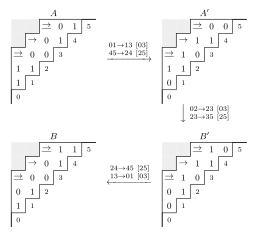
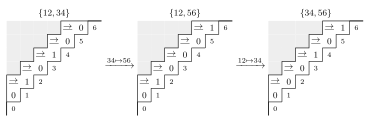
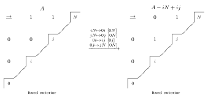
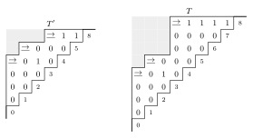
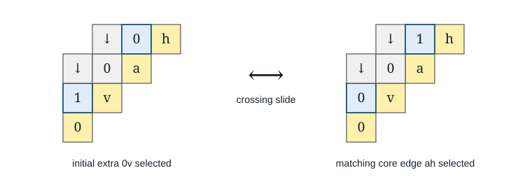

# Connecting states by flips

We prove Lemma~\ref{lem:commonCoverUniqueness}, used to isolate one
component in the preceding section. We first arrange the selected normal
edges according to the terminal vertices of the corner chains. Crossing
slides then move these edges while restoring all exterior selections.
The remaining lemmas extend the resulting paths by induction on the natural
diagram.

## Ordering edges by the terminal vertices

Let $M$ be the maximal natural corners. Throughout this section we mark
all of them strict. Since a corner cannot be exchanged as a short edge,
this changes no flip between the states under consideration.
The corners form disjoint directed chains. Write $r(u)$ for the terminal
vertex of the chain containing $u$, and let $\Gamma$ consist of the
corners together with the normal natural edges $uv$ for which $r(u)<r(v)$.
A natural edge within one corner chain is itself a corner: any longer
interval would contain the first corner on that chain.

Every selected state contained in $\Gamma$ has every corner a cover.
Indeed, along a selected path $r$ increases at every normal edge and stays
constant at every corner. A path bypassing a corner would therefore use
only corners, which cannot bypass a single step of their chain.

::: {.lemma #lem:preparation title="Ordering the terminal vertices"}
Every selected state in which all corners are covers is joined by flips to
a state contained in $\Gamma$. We may retain every originally selected
edge of $\Gamma$. The path preserves the selected size and weak components.
:::

::: {.proof}
We process the corner chains in decreasing order of their terminal
vertices. Let $U$ be the union of the chains already processed. We maintain
that no selected edge leaves $U$, and that all corners are covers at the
start of each chain. Initially $U$ is empty.

Let $B$ be the next chain, with terminal vertex $t$. We remove its selected
exits $vy$ with $r(y)<t$. Such an exit has $v<t$, since $v<y\leq r(y)<t$.
Let $h$ be the corner successor of $v$ in $B$. Maximality of the corner
$vh$ forces $v<y<h$: the edge $vy$ cannot properly contain $vh$.

Fix a vertex $v$ with an exit and choose its least exit head $y$.
Then $vy$ covers. Indeed, an alternate path from $v$ to $y$ cannot enter
$U$ and return. Its first edge cannot be the chain edge $vh$, since
$h>y$. Any other first edge staying outside $U$ would be an exit from
$v$ with a smaller head. Since $vh$ also covers, we ca flip

\[
                       vy\longmapsto yh\qquad[vh].
                       \tag{P}
\]

Here and below, brackets give the retained edge. The new edge lies inside
$vh$, so it is natural and normal; its terminal labels increase.
The flip retains the cover of $vh$. Other corners of $B$ have intervals
with disjoint interiors, so their cover tests are unchanged. No selected
edge from $U$ changes. Each flip removes one exit and inserts none, so
the process terminates.

At the end no edge leaves $U\cup B$. Every inserted edge enters $B$.
An alternate path bypassing a corner outside $U\cup B$ therefore cannot
use an inserted edge: it would enter this union and never leave. Such
a bypass would already have existed before the chain was processed.
Corner covers inside $U$ are unchanged, and those in $B$ were retained
throughout. Thus all corner covers hold again, and we can continue with
the next chain.

When every chain has been processed, all selected normal edges belong to $\Gamma$.
Only edges with decreasing terminal labels were removed, so every original
edge of $\Gamma$ remains. Size and weak blocks are preserved by every flip.
:::

## Local paths of flips

### Crossing slides

We next exchange selected edges across two crossing covers. This will allow
us to change the extra edges of a state in $\Gamma$ while retaining all the others
at the endpoint of the path.

::: {.lemma #lem:crossingSlide title="Crossing slide"}
Let $a<b<c<d$. Suppose $ac$ and $bd$ cover
in $A$, while $ab$ is selected and $cd$ is absent. Then flips join
$A$ to $A-ab+cd$, with every other selected edge restored. Both $ac$
and $bd$ cover at the endpoint.
:::

::: {.proof}
Put

\[
 L=\{v:a<v<b,\ av\in A\},\qquad
 R=\{v:c<v<d,\ vd\in A\}.
\]

First sweep the edges $av$ for $v\in L$ in increasing order, replacing
$av$ by $vc$ across $ac$. At the time of its move, $av$ covers:
an alternate path would start with an edge from $a$ to a smaller vertex,
and these edges have already been removed. The retained $ac$ remains
a cover after each flip. Every changed edge has its smaller endpoint below
$b$, so the changes
do not affect any path inside $[b,d]$; hence $bd$ continues to cover.

Next sweep $vd$ for $v\in R$ in decreasing order, replacing $vd$ by
$bv$ across $bd$. An alternate path from $v$ to $d$ would end with
an edge from a larger vertex, already removed. These are flips
retaining $bd$. Every changed edge has its larger endpoint above $c$, leaving all
paths in $[a,c]$ unchanged, so $ac$ continues to cover as well.

Now $ab$ covers, since there is no selected edge from $a$ into $(a,b)$.
The edge $bc$ is absent: if it had been selected originally, $ab,bc$
would bypass $ac$, and neither sweep inserts it. We perform the two flips

\[
              ab\longmapsto bc\quad[ac],\qquad
              bc\longmapsto cd\quad[bd].                       \tag{S}
\]

After the first, $bd$ still covers. A newly created bypass would have
to start with $bc$, but there is no path from $c$ to $d$: the edge
$cd$ is absent, and the right sweep has removed all incoming edges
to $d$ from $(c,d)$. Thus the second flip is actual. It leaves $bd$
covering and preserves the cover of $ac$, since it removes $bc$ and
inserts an edge leaving $c$.

We restore the right sweep first, in reverse order. For $v\in R$, the
net change $ab\mapsto cd$ affects no edge wholly inside $[b,v]$:
$ab$ starts below $b$, and $cd$ ends above $v$. Hence the cover test
for each $bv$ agrees with its cover test when we reverse the original
right sweep. Starting with the cover $bd$, each reverse flip is actual
and keeps $bd$ covering. These changes affect no path in $[a,c]$.

Finally restore the left sweep in reverse order. For $v\in L$, the net
change affects no edge wholly inside $[v,c]$, so the cover test for $vc$
agrees with its test in the reversed left sweep. Starting with the cover
$ac$, these reverse flips are actual. They do not change paths in $[b,d]$.
Every exchanged edge lies properly inside $ac$ or $bd$, so it cannot
be a maximal natural corner and is normal throughout. We obtain exactly
$A-ab+cd$ in $2+2|L|+2|R|$ flips.
:::

*Figure 2.* We take $a=0,b=2,c=3,d=5$ and retain the strict corners
$03,14,25$. The two sweeps exchange $01\mapsto13$ and $45\mapsto24$.
The central flips give $02\mapsto23\mapsto35$, after which we restore
$24\mapsto45$ and $13\mapsto01$. Underlines mark the retained covers
$03$ and $25$. The corner $14$ may be redundant between the two endpoint
states. Each picture specifies one selected state; the arrows denote paths
of flips, and do not assert equality of individual state values.

### Rearranging edges between two corner chains

For a natural normal edge $uv$, a corner $uh$ gives the short-edge link
$uv\longrightarrow vh$. Maximality of $uh$ implies $v<h$, and $vh$
is natural because it lies inside $uh$. This link exchanges the terminal
labels of the two endpoints. Each normal edge has at most one successor
and at most one predecessor under these links. Both endpoints strictly
increase along a link, so the links form disjoint finite paths.

For any two corner chains there is at most one such path. To see this,
let $uv$ be its first edge. If $v$ had a corner predecessor $p$, then
$p<u$: otherwise $uv$ would equal or properly contain the corner $pv$.
The edge $pu$ would be a predecessor, a contradiction. Thus $v$ is the
first vertex of its chain, and $u$ belongs to the chain starting earlier.
There is at most one possible $u$ in that chain below $v$. Indeed, if
$u<u'<v$ were two choices, the natural interval $uv$ would properly
contain the corner from $u$ to its successor, which is at most $u'$.

Positions inside $\Gamma$ and positions outside $\Gamma$ alternate on each
short-edge path, since a link exchanges the two distinct terminal labels.
Consecutive positions in $\Gamma$ therefore have the form $ab,cd$ with $a<b<c<d$ and corners $ac,bd$.
In a state in $\Gamma$, both corners cover. Whenever exactly one of $ab,cd$ is
selected, Lemma \ref{lem:crossingSlide} exchanges it for the other, restoring
every exterior edge. The endpoint is another state in $\Gamma$.

::: {.lemma #lem:parallelEdge title="Parallel edges"}
Suppose two states in $\Gamma$ select the same number of
normal edges of $\Gamma$ between each pair of corner chains. Then flips
join them.
:::

::: {.proof}
List the positions in $\Gamma$ for one pair in their short-edge order.
We repeatedly exchange an occupied position followed by a vacant one.
The sum of the occupied position indices strictly increases and is bounded,
so we reach the configuration occupying the last positions of that list.
It depends only on the number selected. Each exchange restores every other
edge, so we can do this separately for every pair of chains. Both states in $\Gamma$
reach the same selected diagram. We reverse the path from the second.
:::

::: {.lemma #lem:twoChain title="Two corner chains"}
If there are at most two corner chains, all
states with every corner a cover of a fixed total selected size lie in one flip component.
:::

::: {.proof}
Prepare both states to states in $\Gamma$. If there is at most one chain,
the only state in $\Gamma$ is $M$. With two chains, every selected normal edge joins
that one pair. Equal total size gives equal numbers of normal edges,
so Lemma \ref{lem:parallelEdge} connects the states in $\Gamma$. Reverse the second
preparation path.
:::

*Figure 3.* The corner chains are $0,2,4,6$ and $1,3,5$. The permitted
normal positions are $12,34,56$. Each arrow is the crossing-slide path
between the two indicated states in $\Gamma$, with every other selected edge restored.
Both states on the left reach the state in $\Gamma$ whose two selected edges of $\Gamma$
occupy the last two positions. Each cell picture fixes a selected state;
these path arrows are not identities of individual state values.

## Base cases

### Complete diagrams

We now work in the complete natural diagram on $0,\ldots,N$, with
$N\geq1$. Its only maximal corner is $0N$. The argument applies whether
this corner is normal or strict: every exchanged edge is a proper subedge
of a retained natural edge and hence cannot be strict.

::: {.lemma #lem:completeDiagram title="Complete-diagram connectivity"}
Connected states in which $0N$ covers belong to one flip component at each fixed total selected size.
:::

::: {.proof}
We first introduce the selected chain

\[
                    P_N=\{0N,12,23,\ldots,(N-1)N\},
\]

then rearrange its extra edges. We call these extra edges chords; their
positions are $ij$ with $1\leq i<i+1<j\leq N$.

**Introducing the chain.** Preparation gives a state in $\Gamma$ consisting of
$0N$ and a connected selected graph $H$ on $1,\ldots,N$. Whenever
$ab,ac$ are two outgoing covers of $H$, with $a<b<c$, flip
$ab\mapsto bc$ retaining $ac$. This is a flip: $bc$ is
absent since otherwise $ac$ would not cover. The sum of the tails of
the selected edges strictly increases, so these moves terminate.

The final cover graph has at most one outgoing edge at each vertex.
It is connected, since removing redundant edges preserves weak connectivity.
An undirected cycle would have a least vertex with two outgoing covers,
so the graph is a tree. It has unique sink $N$. Replacing a selected
edge repeatedly by shorter paths until every edge covers shows that its
endpoints are a vertex and an ancestor in this tree.

Suppose $i<j$ are children of $N$. Each has exactly one outgoing
selected edge, to $N$. The following four flips replace $iN$ by $ij$:

\[
 iN\mapsto0i\ [0N],\quad jN\mapsto0j\ [0N],\quad
 0i\mapsto ij\ [0j],\quad 0j\mapsto jN\ [0N].       \tag{T}
\]

For the first two flips, removing a child's sole outgoing edge makes it
a sink. Thus the new edge from zero cannot bypass $0N$. At the third
flip both $i$ and $j$ are sinks, so $0i,0j$ cover. After that flip
zero is adjacent only to the sinks $j,N$, so $0j,0N$ cover and the
final flip is actual. Incoming selected edges
cannot change these cover tests. The new tree replaces the branch
$i\to N$ by $i\to j\to N$, and all old shortcut edges still join
ancestors.

The greatest child of $N$ is $N-1$. Repeatedly apply (T) with $j=N-1$
until it is the only child. The restriction of $H$ to $1,\ldots,N-1$
is then connected. Flip $(N-1)N\mapsto0(N-1)$ across $0N$ and apply
the chain construction inductively inside $0,\ldots,N-1$. Every local
flip remains actual: a forward path between two vertices in this interval
cannot leave through $N$ and return. At the local endpoint, zero has
only the edges $0(N-1),0N$, and $N-1$ has no outgoing edge. Hence
both zero-edges cover, and we flip $0(N-1)$ back to $(N-1)N$.
Starting with $N=1$, this constructs $P_N$ with no other edge at zero.
This induction only introduces the chain; it does not use the chord
rearrangement proved below.

*Figure 4.* The four flips in (T) replace $iN$ by $ij$. The pictures
fix all selected edges on $0,i,j,N$; the remaining selected edges are
the same at both endpoints. At the source, zero is incident only to
$0N$, and the only outgoing selected edge of either child is its edge
to $N$. Arbitrary incoming edges at the children are allowed.

**Using a smaller interval.** Consider two chain states which agree
outside the ordered vertex set $\{0,a,a+1,\ldots,b\}$, where
$0<a\leq b\leq N$. Here agreement outside means agreement on every
selected pair not having both endpoints in this set.
We can lift a path between their restrictions
while restoring the entire exterior.

To do so, open the chain in decreasing order $j=N-1,\ldots,b$:

\[
                j(j+1)\mapsto0j\quad[0(j+1)].                 \tag{O}
\]

The adjacent short edge covers. Before its move, every selected edge
from zero ends at or above $j+1$. After the move the newly reached
vertex $j$ cannot reach $j+1$, since their adjacent edge was removed.
Thus each flip is actual, regardless of the chords.

The opened zero-row has precisely the heads $b,b+1,\ldots,N$.
The restriction to $\{0,a,\ldots,b\}$ is a smaller chain state with
corner $0b$ covering, and is connected by its retained chain.
A forward path testing an edge with both endpoints in
$[a,b]$ stays inside this interval. For an edge from zero, a path cannot
enter a vertex below $a$, since no zero-edge goes there; it cannot return
from a zero-edge ending above $b$. These facts remain true during any
path in the smaller diagram, so all its flips lift. Open the target ambient
chain state by the same procedure. Its restriction is the target of the
local path, and its exterior agrees with the source opening. We can therefore
finish by reversing that target opening in increasing order. This restores
the exterior exactly.

**Rearranging the chords.** We prove the lemma by strong induction on $N$,
using the chain construction above for both endpoints. For $N\geq5$,
apply the smaller-interval construction to $[1,N-1]$ and $[2,N]$.
By induction, within either interval we may rearrange the selected chords
at fixed count, leaving every other edge fixed at the endpoint.
Here we use the full strong induction hypothesis on the smaller connected
complete diagram; the interval construction above supplies the lift.

The two sets of chord positions cover all positions except $1N$, and
their intersection contains $24$. Thus exchanges within these sets connect
all equal-size chord subsets with the same selected status of $1N$.
If no one interval contains both positions of an exchange, we route
through $24$, which is distinct from both. If $24$ is vacant, move the selected edge there first;
if occupied, move it to the vacant destination first. In either case
the second exchange restores the original status of $24$.

It remains to change the $1N$ status. Suppose that $1N$ is absent and
both $13$ and $2N$ are selected. Sweep every selected incoming edge
$iN$, $0<i<N$, in decreasing $i$, replacing it by $0i$ across $0N$.
When $iN$ moves, all incoming edges with larger tails have been removed,
so $iN$ covers. The zero-neighbors created earlier are larger than $i$
and cannot reach an unswept incoming tail; therefore $0N$ covers too.

Now $01$ is absent and $02$ is selected. Flip $12\mapsto01$ across
$02$. The retained $02$ covers because no selected zero-edge has a
smaller head. Reverse the incoming sweep in increasing order, including
the new edge $01$. Each zero-edge being moved has the smallest remaining
head, and all restored incoming tails are smaller than that head. This
gives actual reverse flips and the exact state

\[
                            A-12+1N.                          \tag{U}
\]

We repair the missing chain edge using $13$. Open the chain down to $3$
by (O). On $0,1,2,3$ the selected edges are $03,13,23$, with $12$
absent. Apply the four flips (T) with $i=1,j=2,N=3$, then close the
chain. The smaller-interval cover argument permits all the fixed exterior
chords. We have restored $12$ and removed $13$, obtaining

\[
               A\longmapsto A-13+1N
               \qquad(13,2N\in A,\ 1N\notin A).              \tag{U'}
\]

Let $Q=\binom{N-1}{2}$ be the number of chord positions. If the chord
count $c$ satisfies $2\leq c\leq Q-1$, the fixed-$1N$ rearrangements
let us select $13$ and $2N$ in an outer-absent state. Move (U') then
joins the two possible $1N$ statuses. At counts $0$ and $Q$ there is
only one chord set.

For $c=1$, start from $P_N+13$ and open the chain down to $2$.
Perform

\[
                    13\mapsto01\ [03],\qquad
                    01\mapsto1N\ [0N],
\]

then close the chain. All vertices $2,\ldots,N$ are sinks while the
chain is open, and there are no other chords, so both retained longs
and exchanged shorts cover. The endpoint is $P_N+1N$. Together with
the fixed-status rearrangements, this connects every single-chord state.

For completeness, the induction has the following explicit bases. If
$N\leq3$, there is at most one chord position. For $N=4$, the positions
are $13,14,24$. In the table, a triple $abc$ means the flip exchanging
$ab$ and $bc$ while retaining $ac$; its direction is determined by the
current selected state. Each row starts with $P_4$ plus the indicated
left chord set and ends with $P_4$ plus the right chord set.

| Chord sets | Successive flip triples |
| --- | --- |
| $\{13\}\longrightarrow\{14\}$ | $034,023,013,014,023,034$ |
| $\{14\}\longrightarrow\{24\}$ | $034,124,014,023,012,023,034$ |
| $\{13,24\}\longrightarrow\{14,24\}$ | $034,024,012,014,024,\allowbreak 013,023,012,023,034$ |
| $\{14,24\}\longrightarrow\{13,14\}$ | $034,023,012,013,023,124,034$ |

Inspection of these selected diagrams verifies the short and long covers
at each step. The rows connect every one- and two-chord subset; the zero-
and three-chord subsets are unique. This starts the induction. Finally,
we reverse the chain construction for the second original state.
:::

## Deleting chains and edges

We justify the removable-edge hypothesis needed below directly in the
graph of permitted edges $\Gamma$. Connectivity in this paragraph is undirected.

First, replacing the natural graph by $\Gamma$ preserves connectivity
within any specified union of corner chains. For a natural normal edge
$uv$ with $r(u)>r(v)$, let $uh$ be the corner successor of $u$.
As in preparation, $u<v<h$. We replace the edge $uv$ in a walk by
the two edges $uh,hv$, traversing the latter backwards. The corner $uh$
and edge of $\Gamma$ $vh$ belong to $\Gamma$, and the replacement visits only
the two original corner chains. All other natural edges already belong
to $\Gamma$.

::: {.lemma #lem:chainDeletion title="Chain deletion"}
If a connected ordinary natural graph has at
least three vertices and remains connected after deleting any single vertex,
then deleting all vertices of one
corner chain leaves the other vertices connected in $\Gamma$.
:::

::: {.proof}
Every pair of vertices at distance one or two is a natural edge.
An absent adjacent edge would, by closure under subintervals, exclude every
edge across its cut and disconnect the graph. If $(i-1)(i+1)$ were absent, closure
under subintervals would exclude every natural edge from below $i$ to
above $i$. The vertex $i$ would be an articulation.

Consecutive vertices cannot belong to the same corner chain. Their edge
would be a corner, but it lies properly in a natural edge of length two:
extend it to the left unless its first vertex is zero, and to the right
in that case. Thus removing a corner chain never removes two consecutive
vertices, and at least one vertex survives. Consecutive surviving vertices
differ by at most two and hence
are joined by a natural edge. They form a path through all remaining
vertices. Replace its edges outside $\Gamma$ by the two-edge walks above; these
walks avoid the removed chain.
:::

::: {.lemma #lem:removableEdge title="Removable edge of $\Gamma$"}
Under the same hypotheses, suppose there are
at least three corner chains. Deleting any normal edge of $\Gamma$ from
$\Gamma$ leaves it connected.
:::

::: {.proof}
Let the edge be $uv$, and choose a vertex $w$ in a third chain.
By Lemma \ref{lem:chainDeletion}, a path joins $u$ to $w$ while avoiding the
chain of $v$, and a path joins $w$ to $v$ while avoiding the chain of $u$.
Neither path uses $uv$, so their concatenation goes around that edge.
The full graph $\Gamma$ is connected by the natural-edge replacement
argument. Replacing every use of $uv$ by this walk proves the result.

Equivalently, contraction of the corner chains gives a graph which remains
connected after deleting any one of its vertices. The explicit avoiding
paths above also lift directly to the graph of permitted edges, as needed for the
initial-vertex construction.
:::

## Induction on the diagram

### Removing part of the last clique

Suppose the last two maximal corners are $bc$ and $ae$, where
$b<a<c<e$ and $e$ is the greatest vertex. Put

\[
                      V=\{0,\ldots,c\}\cup\{e\}.
\]

We call the induced diagram on $V$, with its inherited order, the core.
Every corner other than $ae$ has head at most $c$, so all maximal corners
survive this restriction. Every retained edge lies below one of these
retained corners; hence no new maximal corner appears. The removed vertices
are singleton corner chains. Terminal labels of the retained chains keep
their order. Let $\Gamma'$ be the corresponding graph for the core.
Its edges are exactly those of $\Gamma$ with both endpoints in $V$.

Every vertex strictly between $a$ and $e$ is a terminal of its corner
chain. Indeed, every corner other than $ae$ starts below $a$ and ends
at or below $c$. Consequently a state in $\Gamma$ has no selected edge from $a$
except $ae$, and every natural edge with both endpoints strictly above
$a$ belongs to $\Gamma$.

::: {.lemma #lem:lastClique title="Removing part of the last clique"}
Suppose connected states with every corner a cover of each size
in the core belong to one flip component. Then the same holds in the
original diagram.
:::

::: {.proof}
We first make the selected core connected, then select a fixed
tree. The remaining edges can be rearranged using core paths and paths
in the last clique.

**Paths within a selected clique block.** We will use the complete-diagram
lemma inside selected weak blocks of $[a,e]$, enumerating each block in
increasing order and restricting to its induced complete diagram.
Any directed selected path between vertices of such a block stays in
$[a,e]$, by forwardness, and stays in
the block, by its definition. Thus cover tests in the restriction agree
with the ambient tests. A local flip preserves that weak block and lifts
with every other selected edge fixed. This observation applies even when
the vertices of the block are not consecutive.

Prepare the source to a connected state in $\Gamma$. In the selected clique block
$B$ containing $a,e$, the least vertex $a$ has only its edge to $e$.
Apply Lemma \ref{lem:completeDiagram} to replace this block by a star at $e$,
with additional edges among $B\setminus\{a\}$ preserving the count.
Such a target exists: if $|B|=q$, connectedness gives at least $q-1$
edges, while the pendant vertex $a$ gives at most
$1+\binom{q-1}{2}$. The star and its possible additional edges realize
every count between these bounds. The endpoint is again a state in $\Gamma$,
and $B\cap V$ is connected within $V$.

Each other selected clique block meets $S=[a+1,c]$. Otherwise all its
vertices lie in $(c,e)$, have no natural neighbors outside $[a,e]$, and
would form a separate selected weak block of the whole diagram.
We make the intersection of each such block with $S$ connected as follows.

Choose its least vertex $u$, which lies in $S$, and another vertex
$v\leq c$ of the block. Take a path of selected covers from $u$ to $v$,
allowing either direction along an edge. If its greatest vertex $z$ is
above $v$, the two neighbors of $z$ are $i<j<z$. Flip
$jz\mapsto ij$ across $iz$, shortcut the path through $ij$, and replace
any redundant edge of the new path by a path of covers inside its endpoint
interval. The greatest vertex of the path decreases. Repeating gives
a cover path inside $[u,v]$.

Now perform incoming-cover flips inside $[u,v]$ until each vertex has
at most one incoming cover. The sum of selected edge heads strictly
decreases, so this terminates. Each cover component is then an increasing
tree rooted at its least vertex. In particular $u$ reaches $v$.
These operations preserve every connection already obtained below $c$:
a flip removing a peak above $c$ removes no selected edge with both
endpoints below $c$, while a flip wholly below $c$ preserves its selected
weak blocks there. Iterating over the finitely many vertices of the block
connects its whole intersection with $S$. All its vertices are strictly
above $a$, so its endpoint remains a state in $\Gamma$.

The clique-block vertex sets have stayed fixed. Every one now meets $V$
in a connected selected subgraph. Every natural edge lies below a maximal
corner. Since all corners except $ae$ end at or below $c$, all edges
outside $[a,e]$ have both endpoints in $V$. Replacing each excursion of a weak path through
an omitted vertex by a path in its block's retained part shows that the
selected core is connected.

**Replacing the core with the exterior restored.** Start from a state in $\Gamma$
whose core is connected. Sweep every selected $ve$, $c<v<e$, to $av$
across $ae$, in decreasing $v$. These are actual incoming sweeps and leave
all core edges unchanged. Earlier corners end at or below $c$, so their
cover tests are unchanged as well.

After the sweep, no omitted vertex has a selected edge to $e$. Since every
omitted vertex lies strictly between $c$ and $e$, a forward path leaving
$V$ could return only at $e$, with an omitted vertex as its predecessor.
Thus no such path returns. Any actual core path now
lifts with the swept exterior fixed, even when its intermediate states
make a corner redundant. By hypothesis we may use such a path to reach
any connected core state in $\Gamma'$ of the same size.

At its endpoint $a$ has no outgoing core edge except $ae$. Restore the
recorded edges in increasing $v$, replacing $av$ by $ve$ across $ae$.
The remaining swept $a$-neighbors are greater than $v$, while restored
incoming tails at $e$ are smaller than $v$. Hence $av$ and $ae$ cover
at every step. We obtain the desired core and the exact original exterior.

**Selecting a fixed tree.** In the core graph $\Gamma'$, take all corners and
all star edges $ve$ with $a<v\leq c$. This is a forest: each vertex
has at most one outgoing edge, since corner tails are at most $a$ and
the added star tails are greater than $a$. All edges point forward, so
an undirected cycle would have a least vertex with two outgoing edges.
The selected core is connected and its edges belong to $\Gamma'$, so $\Gamma'$
is connected. Extend this forest to a spanning tree in $\Gamma'$, called $T'$.

Inside the last clique, $T'$ consists exactly of its terminal star.
Any additional edge there would close a triangle through $e$. It also
omits the edge $ba$ of $\Gamma'$, since $bc,ce,ae$ already give a path from $b$
to $a$. If the selected core has $s'$ edges, then
$|V|-1\leq s'\leq |\Gamma'|$: the lower bound follows from
connectedness, and the upper bound from the condition of lying in $\Gamma'$.
We may therefore add $s'-(|V|-1)$ edges of $\Gamma'$ to $T'$. This is a
connected state on the core of the original size, so core replacement
realizes it in $\Gamma$.

The whole selected last clique is now connected. Each omitted vertex
had a selected path to its first retained vertex inside $[a,e]$; the
edges before that first retained vertex are exterior to the core and
have stayed fixed. All retained vertices of the last clique now join
$e$ through $T'$. Apply Lemma \ref{lem:completeDiagram} in $[a,e]$ to
select its full terminal star, with additional internal edges preserving
the count and with $a$ still pendant. The part of $T'$ outside the
clique stays fixed, and its part inside is in the final star. We have
reached a state in $\Gamma$ containing the fixed spanning tree

\[
                  T=T'\cup\{ve:c<v<e\}.                     \tag{F}
\]

The added vertices are leaves at $e$, so this is indeed a tree.

*Figure 5.* Here the corners are $04,15,38$, so $b=1,a=3,c=5,e=8$.
We retain the core vertices $0,1,2,3,4,5,8$. The left picture specifies
$T'$; the right specifies $T$, obtained by attaching $6$ and $7$ at
$8$. The star inside the core is $38,48,58$, and the shared extra
position $ba=13$ is absent from both trees. Each picture fixes one
selected state. In the proof we add edges of $\Gamma$ to these trees to recover
the required selected size.

**Exchanging the extra edges.** Let $P=\Gamma\setminus T$. Let $P_C$
be its positions with both endpoints in $V$, and put

\[
             P_R=\bigl(P\cap\{uv:a<u<v<e\}\bigr)\cup\{ba\}.
\]

Interval closure of $ae$ makes all the internal pairs in this formula
natural. They belong to $\Gamma$ and lie outside $T$, whose last-clique edges
form the star at $e$. Thus $P_R=\{uv:a<u<v<e\}\cup\{ba\}$.
Every position in $\Gamma$ outside $V$ lies in the last clique. Thus
$P=P_C\cup P_R$, and $ba\in P_C\cap P_R$.
Core replacement realizes every fixed-count rearrangement in $P_C$,
with $T$ and all other extras restored at the endpoint.

Two internal positions of $P_R$ can be exchanged using the complete-diagram
lemma in $[a,e]$: both endpoints contain the terminal star, and are
therefore connected states in $\Gamma$ of equal size. This restores every other edge.
To exchange $ba$ with an internal position, we need one additional step.

Suppose $p=ba$ is selected and an internal extra $x$ is absent. Write
$q=ce$. Choose an endpoint $d$ of $x$ different from $c$, and let $r$
be the natural edge between $c$ and $d$. If $r$ is selected, the clique
remains connected after replacing $q$ by $x$: the vertex $c$ joins $d$
through $r$, and $d$ still joins $e$ through the star. Both source and
target are states in $\Gamma$ with $a$ pendant, so Lemma \ref{lem:completeDiagram}
realizes this replacement while fixing the exterior. Now $q$ is absent.
The crossing slide across $bc,ae$ exchanges $p$ for $q$, restoring the
full star and giving exactly $A-p+x$.

If $r$ is absent, first carry out the same construction with $r$ in
place of $x$. The inserted $r$ itself repairs the missing star edge.
This gives $A-p+r$ with the full star restored. If $r=x$, we are done;
otherwise exchange the two internal extras $r$ and $x$ as above. The
reverse path gives exchanges in the other direction. The star edge $ce$
may be absent temporarily, but every edge of $T$ is restored at the
final endpoint.

Finally, consider one position in $P_C\setminus P_R$ and another in
$P_R\setminus P_C$, one selected and the other vacant. Both differ
from the shared position $ba$. When $ba$ is absent, move
the selected position to $ba$ and then to the vacant position. When it
is selected, perform these two exchanges in the opposite order. In both
cases its original status is restored. Thus all subsets of $P$ with
the same cardinality are connected by flip paths with $T$ at
the endpoints. Since $|T|$ is fixed, this connects all the normalized
states in $\Gamma$ of the original selected size. Reverse the second preparation
to finish the proof.

Reversing the vertex order gives the first-clique version of the lemma.
This reverses the actual paths and their cover tests; no equality of
coloring or elementary values under order reversal is used.
:::

### Removing the first vertex

We first treat the case in which the first two maximal corners are
$0a$ and $1b$, with $1<a<b$. Let $D'$ be the induced diagram on
$1,\ldots,n-1$. Deleting zero removes the corner $0a$. Every edge left
from its clique lies in the clique $[1,b]$, so no new maximal corner appears.
The other corner chains lose no successors, and therefore retain their
terminal vertices.

Write $r'(u)$ for the terminal vertex of the corner chain containing $u$ in
$D'$. Let $\Gamma'$ consist of the corners of $D'$ together with its normal
natural edges $uv$ satisfying $r'(u)<r'(v)$.
The terminal labels of the retained corner chains are unchanged.

It follows that

\[
 \begin{gathered}
 \Gamma=\{0a\}\,\sqcup\,\Gamma'\,\sqcup\,\{0v:v\in J\},\\
 J\coloneqq\{v:0<v<a,\ r(a)<r(v)\}.
 \end{gathered}
 \tag{1}
\]

Indeed, an edge of $\Gamma$ at zero is either $0a$ or an edge $0v$ with
$v<a$ and $r(0)=r(a)<r(v)$. Every other edge lies in the core, where
both its terminal labels and its corner status are unchanged.

For $v\in J$, let $vh_v$ be its corner successor. Such a successor
exists: $r(v)>r(a)\geq a>v$. Moreover, $h_v>a$, since a maximal corner
starting between zero and $a$ cannot end within $[0,a]$. The edge
$d_v\coloneqq ah_v$ is a normal edge of $\Gamma'$. The crossing slide
exchanges $0v$ and $d_v$, with the corners $0a$ and $vh_v$ retained.

*Figure 6.* The diagonal lists the ordered vertices $0<v<a<h=h_v$.
The cell in column $u$ and row $w$ represents the edge $uw$.
Arrows denote the two retained corner covers, and $1$ and $0$ denote
selected and absent normal edges. The edge $va$ is natural because it
lies in $[0,a]$, but a state in $\Gamma$ does not select it since $r(v)>r(a)$.
The displayed change is a path of flips; every
other edge, including edges on vertices omitted from the figure, is
restored at its endpoint.

::: {.lemma #lem:initialVertex title="Removing the first vertex"}
Suppose that connected states with every corner a cover of
each size in $D'$ belong to one flip component. Suppose also that
$\Gamma'\setminus\{d_v\}$ is connected for every $v\in J$.
Then connected states with every corner a cover of each size in $D$ belong to one
flip component.
:::

::: {.proof}
We prepare the two states to states in $\Gamma$. We first make each selected
core connected, then change its extra edges at zero.

Let $A$ be a connected state in $\Gamma$ whose selected core is disconnected, and
let $B$ be the core component containing $a$. Some selected edge $0v$
enters a different core component. Otherwise all selected neighbors of
zero would lie in $B$, contradicting connectedness of $A$. The edge
$0v$ is an extra, since $0a$ enters $B$. The selected corner $vh_v$
puts $h_v$ in the same core component as $v$. Hence $ah_v$ is absent.
We apply the crossing slide in Figure 6. The core gains $ah_v$ and loses
no edge, while the initial row loses $0v$. Repeating this operation
terminates because the number of selected initial extras decreases.

Now fix the set $S\subseteq J$ of selected extras and the total selected
size $s$. The core has size $t=s-1-|S|$. Any two connected core states in $\Gamma'$
of this size are connected by the hypothesis on $D'$. Every core flip
lifts with $0a$ and all edges $0v$, $v\in S$, fixed: a forward path
between positive vertices cannot pass through zero. At the end of the core
path, all selected edges again belong to $\Gamma$, so the endpoint is an
ambient state in $\Gamma$. Thus the states in $\Gamma$ with fixed $S$ and
connected core are connected.

Put $r=n-2$ and $m=|\Gamma'|$. The corner edges of the core form a
forest. In a connected graph of permitted edges we extend this forest to a
spanning tree, then add edges. Consequently a connected core state in $\Gamma'$
exists at every size $r,\ldots,m$. The possible sets $S$ are exactly

\[
 S\subseteq J,\qquad
 \max(0,s-1-m)\leq |S|\leq\min(|J|,s-1-r).
 \tag{2}
\]

Suppose that $v\in S$ and both $S$ and $S\setminus\{v\}$ satisfy (2).
Their core sizes are $t$ and $t+1$, so $r\leq t\leq m-1$.
By hypothesis the graph $\Gamma'\setminus\{d_v\}$ is connected. Its
corner forest extends to a spanning tree, and we add edges of $\Gamma'$ to
obtain a connected core state in $\Gamma'$ of size $t$ omitting $d_v$. We lift
this state in $\Gamma$ with exactly the initial extras $S$. The crossing slide
replaces $0v$ by $d_v$. Its endpoint has connected core of size $t+1$
and initial extras $S\setminus\{v\}$. The fixed-$S$ paths on either
side connect any two states in $\Gamma$ in these neighboring cases.

The sets in (2) are connected by these insertions and deletions. To see
this, first adjust cardinality within the permitted interval. To exchange
an unwanted element for a wanted one at a fixed size, delete first if
the size is above the lower bound, and insert first otherwise. The only
possible obstruction would be an intermediate band of just one size.
If $J$ is nonempty, the removable-edge hypothesis gives $m\geq r+1$,
which excludes this obstruction: a one-size band is then either
$\{\varnothing\}$ or $\{J\}$. If $J$ is empty there is only one set.
We concatenate these paths and reverse the preparation of the target.
:::

## Proof of the connectivity lemma

::: {.proof title="Proof of Lemma \ref{lem:commonCoverUniqueness}"}
We induct on the number of vertices. We use the complete-diagram
and two-corner-chain path lemmas for the base cases. Otherwise write the
first two corners as $0a$ and $bc$. Consecutive maximal cliques overlap
in at least two vertices, so $0<b<a<c$.

If $b>1$, the reflected last-clique lemma reduces to the induced core
on $\{0,b,b+1,\ldots,n-1\}$. The first retained clique and its successor
still overlap in at least two vertices, and all later overlaps are
unchanged. The core has fewer vertices and no articulation, so induction
supplies its required path theorem.

If $b=1$, deleting zero removes just $0a$. The remaining graph has fewer
vertices. Its maximal cliques start with $[1,c]$ and thereafter have the
same overlaps as before, so it stays connected without articulation.
Deleting zero removes one vertex and one corner edge; hence the number of
corner chains is unchanged. Outside the two-chain base case, at least
three chains remain, so the core has at least three vertices. The removable-edge
lemma therefore applies to every matching edge $d_v$, verifying the
remaining hypothesis of Lemma \ref{lem:initialVertex}.

An initial path may be adjoined to this graph. We remove its pendant
vertices one at a time. Each has just one natural edge, which must be
selected in a connected state, and every core flip lifts. Reversing
these restrictions gives the same uniqueness statement for the graph
with its initial path.
:::
